# vDeck — dokumentacja projektowa

> Status: opis zaimplementowanego stanu systemu · Aktualizacja: 2026-10-12

Dokument opisuje, **co system robi i jak to realizuje**. Uzasadnienia decyzji projektowych znajdują się
w [`.docs/architectural_decisions.md`](../.docs/architectural_decisions.md) oraz
[`.docs/design.md`](../.docs/design.md) i nie są tutaj powielane.

Opisane jest wyłącznie zachowanie już zaimplementowane. Obszary zaplanowane, ale nieukończone, są
wymienione w sekcji [9. Stan implementacji i znane ograniczenia](#9-stan-implementacji-i-znane-ograniczenia)
i wyraźnie oznaczone jako niezrealizowane.

---

## Spis treści

- [1. Wprowadzenie](#1-wprowadzenie)
  - [1.1 Przeznaczenie systemu](#11-przeznaczenie-systemu)
  - [1.2 Moduły i stos technologiczny](#12-moduły-i-stos-technologiczny)
  - [1.3 Uruchomienie panelu](#13-uruchomienie-panelu)
  - [1.4 Budowanie dystrybucji](#14-budowanie-dystrybucji)
  - [1.5 Instrukcja obsługi](#15-instrukcja-obsługi)
  - [1.6 Ciągła integracja i wydania](#16-ciągła-integracja-i-wydania)
  - [1.7 Launcher i automatyczna aktualizacja](#17-launcher-i-automatyczna-aktualizacja)
- [2. Architektura aplikacji](#2-architektura-aplikacji)
  - [2.1 Podział na pakiety](#21-podział-na-pakiety)
  - [2.2 Start aplikacji](#22-start-aplikacji)
  - [2.3 Obsługa wyjątków](#23-obsługa-wyjątków)
- [3. Konfiguracja](#3-konfiguracja)
  - [3.1 Dwa kanały konfiguracji](#31-dwa-kanały-konfiguracji)
  - [3.2 Ustawienia panelu w vDeck.properties](#32-ustawienia-panelu-w-vdeckproperties)
  - [3.3 Rozwiązywanie ścieżek](#33-rozwiązywanie-ścieżek)
  - [3.4 Komponenty konfiguracji](#34-komponenty-konfiguracji)
  - [3.5 Tłumaczenia interfejsu](#35-tłumaczenia-interfejsu)
- [4. Uwierzytelnianie i dostęp do panelu](#4-uwierzytelnianie-i-dostęp-do-panelu)
  - [4.1 Zakres funkcjonalności](#41-zakres-funkcjonalności)
  - [4.2 Model danych](#42-model-danych)
  - [4.3 Domyślne konto administratora](#43-domyślne-konto-administratora)
  - [4.4 Logowanie](#44-logowanie)
  - [4.5 Zmiana hasła](#45-zmiana-hasła)
  - [4.6 Sesje i wylogowanie](#46-sesje-i-wylogowanie)
  - [4.7 Komponenty feature'a](#47-komponenty-featurea)
- [5. Warstwa interfejsu użytkownika](#5-warstwa-interfejsu-użytkownika)
  - [5.1 Zasoby statyczne i arkusze stylów](#51-zasoby-statyczne-i-arkusze-stylów)
  - [5.2 Wyspa akcji](#52-wyspa-akcji)
  - [5.3 Ikony](#53-ikony)
  - [5.4 Ekrany panelu](#54-ekrany-panelu)
  - [5.5 Menu boczne](#55-menu-boczne)
  - [5.6 Serwer i Ustawienia gry](#56-serwer-i-ustawienia-gry)
  - [5.7 Uruchamianie serwera](#57-uruchamianie-serwera)
  - [5.8 Przycisk strony głównej](#58-przycisk-strony-głównej)
  - [5.9 Techniczny helper CTRL+C](#59-techniczny-helper-ctrlc)
  - [5.10 Zatrzymanie, snapshoty i odzyskiwanie](#510-zatrzymanie-snapshoty-i-odzyskiwanie)
  - [5.11 Konsola](#511-konsola)
- [6. Bezpieczeństwo](#6-bezpieczeństwo)
- [7. Persystencja](#7-persystencja)
- [8. Logowanie zdarzeń](#8-logowanie-zdarzeń)
- [9. Stan implementacji i znane ograniczenia](#9-stan-implementacji-i-znane-ograniczenia)
- [10. Indeks diagramów](#10-indeks-diagramów)

---

## 1. Wprowadzenie

### 1.1 Przeznaczenie systemu

vDeck jest lokalnym panelem webowym do zarządzania dedykowanym serwerem Valheim. Aplikacja jest
dystrybuowana razem z instalacją serwera, uruchamiana na tej samej maszynie i obsługiwana z poziomu
przeglądarki. Docelowy zakres produktu obejmuje sterowanie cyklem życia serwera, konfigurację profilu
uruchomieniowego, zarządzanie światami i kopiami bezpieczeństwa, podgląd logów, listy graczy oraz
opcjonalne RCON i mody. Obecnie zaimplementowana jest infrastruktura konfiguracji, uwierzytelnianie
dostępu do panelu, profil uruchomieniowy, Start, Stop, ręcznie potwierdzony Kill, snapshoty i minimalne recovery.

Wspierany jest wyłącznie Windows.

### 1.2 Moduły i stos technologiczny

| Moduł Maven | Odpowiedzialność | Stan |
|---|---|---|
| `vdeck-runtime` | Czysta Java: proces serwera i jego stan. Bez Springa. | Fasada runtime, kolejka zdarzeń i launcher Windows przez FFM |
| `vdeck-runner` | Czysta Java: wykonywalny helper CTRL+C. Bez Springa. | `VdeckRunner`, samodzielny `vdeck-runner.jar` |
| `vdeck-launcher` | Czysta Java: program startowy, sprawdzenie i przygotowanie aktualizacji. Bez Springa. | `VdeckLauncher`, samodzielny `vdeck-launcher.jar` (sekcja [1.7](#17-launcher-i-automatyczna-aktualizacja)) |
| `vdeck-updater` | Czysta Java: dziennikowana podmiana plików, scalanie ustawień, recovery. Bez Springa i sieci. | `VdeckUpdater`, samodzielny `vdeck-updater.jar` uruchamiany z executora |
| `vdeck-app` | Aplikacja Spring Boot: web, bezpieczeństwo, konfiguracja, persystencja. | Feature'y panelu, w tym walidacja i przygotowanie startu |
| `.dist` (`vdeck-dist`) | Końcowy moduł pakujący. | ZIP z czterema JAR-ami, JRE 25, BAT-em, README, instrukcją obsługi PDF i domyślną konfiguracją |

`vdeck-app`, `vdeck-runner`, `vdeck-launcher` i `vdeck-updater` zależą od `vdeck-runtime`, bez zależności
między sobą; launcher uruchamia updater i panel wyłącznie jako osobne procesy. Wspólny kontrakt startu
i aktualizacji leży w pakiecie `runtime.installation`. Runtime otrzymuje gotowy bean `ConsoleControlSender`
i nie zna modułu runnera. Moduł `.dist` zależy od czterech wykonywalnych modułów, aby pakować ich
gotowe artefakty. Launcher dodatkowo korzysta z `tools.jackson.core:jackson-core` (strumieniowy
parser JSON odpowiedzi GitHuba).

Stos: Java 25, Maven (wrapper 3.9.16), Spring Boot 4.1.0, Spring MVC + Thymeleaf, Spring Security,
Spring Data JPA + SQLite (`org.xerial:sqlite-jdbc`), Log4j2 jako jedyne API i backend logowania,
Lombok, JUnit 5 + AssertJ + Mockito.

### 1.3 Uruchomienie panelu

Port panelu w `application.yaml` wynosi `8085`. Plik nie ustawia adresu nasłuchu; uruchomienie
przeznaczone wyłącznie do obsługi lokalnej wymaga `--server.address=127.0.0.1`.

Paczka dystrybucyjna zawiera pełne JRE 25 dla Windows x64. Nie wymaga Javy zainstalowanej
w systemie ani ustawionego `JAVA_HOME`. Jej zawartość należy wypakować do instalacji Valheim,
tak aby `start-vDeck.bat` leżał obok `valheim_server.exe`:

```powershell
D:\sciezka\do\instalacji\start-vDeck.bat
```

Wszystkie JAR-y leżą w podkatalogu `lib`. Skrypt ustawia katalog roboczy na swój katalog i uruchamia
launcher `jre\bin\java.exe -Xmx32m -XX:+UseSerialGC -XX:TieredStopAtLevel=1 -jar lib\vdeck-launcher.jar`
z jawnym `-Dvdeck.server-directory` równym katalogowi skryptu — bez niego `ApplicationHome`
wskazałby `lib`. Launcher (sekcja [1.7](#17-launcher-i-automatyczna-aktualizacja)) czyta
`.vDeck/config/vDeck-start.properties`: `panel.address` (domyślnie `127.0.0.1`) przekazuje panelowi
jako `--server.address`, `panel.port` (domyślnie `8085`) jako `--server.port`, a `update.enabled`
(domyślnie `true`) włącza automatyczne aktualizacje. Panel startuje z `--enable-native-access=ALL-UNNAMED`.
Adres inny niż `127.0.0.1` wystawia panel HTTP do sieci, więc należy go używać tylko w zaufanej sieci.
Inne dodatkowe argumenty skryptu trafiają do Springa; portu nie należy podawać jako argumentu,
bo zdublowana właściwość daje wartość `8085,8086`. Brak JRE lub JAR-a przerywa uruchomienie
z komunikatem. Skrypt nie korzysta z Javy z `PATH`.
Helper CTRL+C używa `javaw.exe` z tego samego JRE. Domyślny adres panelu:
`http://127.0.0.1:8085`; pierwsze logowanie to `admin` / `admin` z wymuszoną zmianą hasła.

Artefakty mają stałe nazwy `vdeck.jar`, `vdeck-runner.jar`, `vdeck-launcher.jar` i `vdeck-updater.jar`.
Katalog instalacyjny opisuje sekcja [3.3](#33-rozwiązywanie-ścieżek). Paczka zawiera szablony
`.vDeck/config/vDeck.properties`, `.vDeck/config/valheim-server.properties` i
`.vDeck/config/vDeck-start.properties`; baza `vdeck.db` powstaje przy pierwszym uruchomieniu.
Paczka służy pierwszej instalacji; kolejne wersje instaluje automatyczna aktualizacja, która
zachowuje ustawienia, bazę i światy.

Uruchomienie z IDE lub przez `spring-boot:run` **wymaga** wskazania katalogu instalacyjnego, ponieważ
bez niego `ApplicationHome` wskazuje na `vdeck-app/target/classes`. Panel nie startuje, jeżeli w tym
katalogu nie ma `valheim_server.exe` (sekcja [2.2](#22-start-aplikacji)); w sandboxie bez serwera gry
należy dodać `-Dvdeck.server-file-check=false`:

```powershell
.\mvnw.cmd install -DskipTests
New-Item -ItemType Directory -Force D:\sciezka\do\sandboxa\lib
Copy-Item vdeck-runner\target\vdeck-runner.jar D:\sciezka\do\sandboxa\lib\vdeck-runner.jar
.\mvnw.cmd -pl vdeck-app spring-boot:run `
  "-Dspring-boot.run.jvmArguments=--enable-native-access=ALL-UNNAMED -Dvdeck.server-directory=D:\sciezka\do\sandboxa"
```

### 1.4 Budowanie dystrybucji

Pełny build z głównego katalogu repozytorium wymaga JDK 25:

```powershell
.\mvnw.cmd clean package
```

Wynik to `target/vDeck-dist-<wersja projektu>.zip`; wersja pochodzi z głównego `pom.xml`.
ZIP nie zawiera dodatkowego katalogu nadrzędnego. Skład paczki określa `.dist/assembly.xml`:
cztery JAR-y w `lib`, `start-vDeck.bat`, README.md, README.txt, instrukcję obsługi `vDeck-instrukcja.pdf`,
trzy pliki `.vDeck/config/*.properties` i pełny katalog `jre` z informacjami licencyjnymi. Baza, logi, pliki builda i cache pobrań
nie są pakowane. Pliki Valheim instaluje się osobno.

Końcowy moduł `.dist` wymusza kolejność przez zależności od aplikacji, runnera, launchera i updatera.
W `prepare-package` Maven AntRun pobiera przypięte wydanie Temurin JRE 25 dla Windows x64
i sprawdza SHA-256 z `.dist/pom.xml` przed rozpakowaniem. Błąd pobrania, sumy lub struktury JRE
przerywa build. Każdy build odtwarza `.dist/jre`, aby usunąć pozostałości poprzedniego wydania.
W tej samej fazie Asciidoctor Maven Plugin z AsciidoctorJ PDF konwertuje instrukcję obsługi
(sekcja [1.5](#15-instrukcja-obsługi)) do `.dist/target/instrukcja/vDeck-instrukcja.pdf`; ostrzeżenie
konwersji, np. brakujący obrazek, przerywa build.
W fazie `package` Maven Resources kopiuje wykonywalne JAR-y bez filtrowania,
a Maven Assembly tworzy ZIP. Zwykłe `test` nie pobiera JRE i nie pakuje dystrybucji.

JRE jest pobierane przy pierwszym `package` po `clean`. Kolejne `package` korzysta z archiwum
w `.dist/target`, ponownie sprawdzając sumę. `clean` usuwa wygenerowane JAR-y, JRE i wyniki
buildu, zachowując wersjonowane szablony `.dist`. Próby uruchomienia wykonuje się na wypakowanej
paczce poza `.dist`, aby nie zmieniać domyślnych ustawień przeznaczonych do dystrybucji.


Źródło diagramu: [`diagramy/wspolne/przeplyw-pakowanie-dystrybucji.mmd`](diagramy/wspolne/przeplyw-pakowanie-dystrybucji.mmd)

### 1.5 Instrukcja obsługi

Polska instrukcja dla użytkownika końcowego powstaje z
[`instrukcja-uzytkownika/instrukcja-uzytkownika.adoc`](instrukcja-uzytkownika/instrukcja-uzytkownika.adoc)
i trafia do paczki jako `vDeck-instrukcja.pdf` (AD-022). Opisuje instalację, pierwsze logowanie,
nawigację, ekrany *Serwer* i *Ustawienia gry*, uruchamianie i zatrzymywanie serwera, zmianę hasła,
portu i adresu, pliki danych oraz rozwiązywanie problemów. Wersja w stopce stron pochodzi z `pom.xml`,
a wygląd z motywu `instrukcja-uzytkownika/motyw/vdeck-theme.yml`, który wykorzystuje tło panelu na okładce.

Zrzuty ekranu w `instrukcja-uzytkownika/img/` odtwarza skrypt Playwright
`instrukcja-uzytkownika/zrzuty/zrzuty-ekranu.mjs`. Uruchamia się go ręcznie na panelu ze świeżo
wypakowanej paczki: skrypt zmienia hasło administratora, zapisuje przykładowy profil, wykonuje kadry
pojedynczych sekcji i oznacza ważne miejsca ramkami oraz numerami. Rysunki instrukcji mają źródła
`.mmd` w `instrukcja-uzytkownika/rysunki/` i są renderowane do PNG. Zasady aktualizacji opisuje
`.docs/rules/documentation.md` §3.6.

### 1.6 Ciągła integracja i wydania

Workflow GitHub Actions [`.github/workflows/build.yml`](../.github/workflows/build.yml) działa na
`windows-latest`, ponieważ testy runtime wywołują `kernel32` przez FFM. Uruchamia się przy każdym
pushu oraz przy pull requeście do `main`, instaluje Temurin JDK 25 z cache repozytorium Maven
i najpierw odczytuje wersję projektu (`help:evaluate`) z głównego `pom.xml`. Skrypt PowerShell
odczytuje rodzaj zdarzenia i ref ze zmiennych środowiskowych `GITHUB_EVENT_NAME` i `GITHUB_REF`,
więc nazwa gałęzi nie jest wstawiana do kodu skryptu.

Release powstaje wyłącznie wtedy, gdy jednocześnie (AD-023):

- zdarzeniem jest push na gałąź `main`;
- wersja nie kończy się na `-SNAPSHOT`;
- w repozytorium nie istnieje jeszcze tag `v<wersja>`.

W każdym innym przypadku job uruchamia tylko `mvnw test` i loguje powód pominięcia releasu. Dla
wydania wykonuje `mvnw clean package` (testy, JRE, PDF instrukcji, ZIP — sekcja
[1.4](#14-budowanie-dystrybucji)), sprawdza obecność `target/vDeck-dist-<wersja>.zip` i przez
`gh release create --latest` publikuje GitHub Release `vDeck <wersja>` z tym ZIP-em, oznaczony jako
najnowszy, bo z niego aktualizują się zainstalowane kopie (sekcja [1.7](#17-launcher-i-automatyczna-aktualizacja)).
Polecenie tworzy tag `v<wersja>` na budowanym commicie, a opis wydania generuje z historii zmian.
Repozytorium ma włączone immutable releases, więc opublikowany zasób nie może zostać podmieniony. Błąd odczytu tagów
przerywa job zamiast traktować tag jako nieistniejący. Przy nieudanym buildzie raporty Surefire
trafiają do artefaktu `surefire-reports` (retencja 7 dni). Każdy ref ma osobną grupę współbieżności
w obrębie workflow. Na `main` działa jeden build naraz, a do 100 kolejnych czeka w kolejce
(`queue: max`, `cancel-in-progress: false`); nowy push nie wypiera oczekującego wydania.
Po wyczerpaniu limitu kolejki GitHub anuluje dodatkowe przebiegi. Dla pozostałych refów nowy build
anuluje poprzedni i zastępuje oczekujący (`queue: single`, `cancel-in-progress: true`).

Wydanie nowej wersji polega na ustawieniu jej we wszystkich POM-ach reactora i scaleniu zmiany
do `main`:

```powershell
.\mvnw.cmd versions:set -DnewVersion=0.1.0 -DgenerateBackupPoms=false
```

Kolejny push bez zmiany wersji nie tworzy ponownie wydania, bo tag już istnieje. Po wydaniu wersję
podnosi się do następnego `-SNAPSHOT`.


Źródło diagramu: [`diagramy/wspolne/przeplyw-ci-wydanie.mmd`](diagramy/wspolne/przeplyw-ci-wydanie.mmd)

### 1.7 Launcher i automatyczna aktualizacja

Automatyczna aktualizacja działa wyłącznie przy starcie (AD-024): skrypt → launcher → sprawdzenie →
ewentualna aktualizacja → panel. Wspólny kontrakt — blokady, przekazanie kontroli, stałe ścieżki,
nagłówek dziennika, lista plików paczki — leży w `com.github.pplociennik.vdeck.runtime.installation`.

**Blokady.** Każdy start zdobywa bez czekania bramkę `.vDeck/startup.lock` (`InstallationLock.Kind.STARTUP_GATE`)
i blokadę instalacji `.vDeck/vdeck.lock` (`InstallationOwnership.tryTake`). Zajęta blokada kończy start
komunikatem, bez sprzątania. Dopiero właściciel obu blokad usuwa stare deskryptory przekazania,
stosuje retencję logów i rozpoznaje dziennik `UpdateCleanup.inspect()`:

| Stan `.vDeck/update/apply.journal` | Działanie launchera |
|---|---|
| brak | usunięcie nieopublikowanych `executor`, `staged`, `merged`, `download`, `.tmp-*` |
| `COMMITTED` albo `ROLLED_BACK` | przeniesienie dziennika do `update/backup/apply-<id>.journal`, potem usunięcie plików roboczych |
| inny albo nieczytelny | przekazanie instalacji updaterowi z executora w trybie `--recover`; brak executora zatrzymuje start |

**Ustawienia startu.** `StartSettings` czyta `vDeck-start.properties` (tworzy go z wartościami domyślnymi,
gdy brakuje). Brak klucza oznacza wartość domyślną, błędna wartość (`panel.port` poza 1–65535, adres
spoza IPv4/IPv6/nazwy hosta, `update.enabled` inne niż `true`/`false`) zatrzymuje start komunikatem
z nazwą klucza (`InvalidStartSettingException`).

**Sprawdzenie i przygotowanie.** Launcher sprawdza aktualizacje tylko przy `update.enabled=true`, wersji
wydania (manifest `Implementation-Version` bez `-SNAPSHOT`), bez `--after-update` i gdy
`ServerActivityCheck` nie wykrywa `server.pid` ani procesu `valheim_server.exe` tej instalacji.
Każde pominięcie poza `--after-update` jest widoczne w konsoli: wyłączone aktualizacje
(`UPDATES_DISABLED`), wersja deweloperska (`DEVELOPMENT_BUILD`) albo możliwy działający serwer
(`SERVER_POSSIBLY_ACTIVE`).
`UpdatePreparation` wykonuje w jednym wątku, pod jednym monotonicznym sufitem bezpieczeństwa
60 minut (AD-027):

1. `GitHubReleaseClient`: `GET https://api.github.com/repos/Pplociennik/vDeck/releases/latest`, połączenie
   do 5 s, pełna odpowiedź do 15 s i 1 MiB. Wymaga tagu `v<MAJOR.MINOR.PATCH>`, dokładnie jednego zasobu
   `vDeck-dist-<wersja>.zip`, rozmiaru 1 B–512 MiB, pola `digest` `sha256:<64 hex>` i adresu HTTPS
   `github.com/Pplociennik/vDeck/releases/download/…`. `404` oznacza brak wydania. Instalowana jest tylko
   wersja ściśle nowsza (`ReleaseVersion`); nie ma obniżania wersji.
2. `ReleaseDownloader`: strumieniowe pobranie do `.part` z SHA-256 w locie, dokładnie zadeklarowany
   rozmiar, porównanie skrótu w stałym czasie, publikacja przez atomowy rename. Nagłówki muszą przyjść
   w 30 s. Strażnik bezczynności zamyka strumień, gdy przez 30 s (`STALL_TIMEOUT`) nie przyszedł żaden
   bajt, co przerywa także zablokowany odczyt; wolne, ale postępujące pobieranie trwa aż do sufitu.
   Co 10 s (`PROGRESS_INTERVAL`) konsola pokazuje postęp, np.
   `Pobieranie: 42,0 z 98,3 MB (42%), 0,8 MB/s`.
3. `PackageExtractor`: rozpakowanie biblioteką zip4j do `.tmp-staged-<uuid>`; zip4j odrzuca wpisy
   wychodzące poza ten katalog. Paczka ma już potwierdzony skrót SHA-256 z API, a updater instaluje
   wyłącznie pozycje `DistributionItem`, więc własna walidacja nazw wpisów nie jest potrzebna. Po
   rozpakowaniu `DurableFiles.forceTree` zrzuca pliki na dysk. Wymaga kompletu plików, wersji wydania w manifestach launchera i updatera oraz obsługiwanego
   protokołu recovery (`Vdeck-Recovery-Protocol: 1`). Publikacja jako `staged` przez atomowy rename.
4. `UpdateExecutorPreparation`: kopia `staged/jre` i `vdeck-updater.jar` do `.tmp-executor-<uuid>`,
   każda zweryfikowana skrótem, i publikacja jako `executor`.

Po przekroczeniu sufitu wątek główny wywołuje `HttpClient.shutdownNow()`, przerywa wątek roboczy
i czeka na jego zakończenie (`UpdatePreparationException.isWorkerStopped()`); dopiero wtedy usuwa
pliki robocze i uruchamia bieżącą wersję. Każdy błąd przygotowania kończy się startem bieżącej wersji.

**Przekazanie kontroli.** `SuccessorStarter` uruchamia następcę w tej samej konsoli z `--handoff <id>`,
a `HandoffProtocol` publikuje w `.vDeck/handoff` jednorazowy deskryptor z rolą (`HandoffRole`)
i tożsamościami obu procesów, zwalnia tylko `vdeck.lock` i czeka do 10 s na potwierdzenie. Następca
sprawdza rolę, własną tożsamość i tożsamość rzeczywistego rodzica, przejmuje blokadę i zapisuje
potwierdzenie. Bez potwierdzenia poprzednik kończy własnego następcę i odzyskuje blokadę albo
zatrzymuje się bez zmian. Panel przejmuje blokadę przed Springiem w `InstallationLockService`;
launcher trzyma bramkę aż do zakończenia panelu i zwraca jego kod wyjścia. Adres panelu
(`ConsoleMessage.PANEL_ADDRESS`) i prośbę o pozostawienie okna (`KEEP_WINDOW_OPEN`) wypisuje sam panel
po `ApplicationReadyEvent` (`config.PanelAddressAnnouncer`), więc są ostatnimi liniami startu.
Launcher przekazuje panelowi `-Dvdeck.open-browser=true` (`UpdateLayout.PANEL_OPEN_BROWSER_PROPERTY`),
więc osobny listener `config.PanelBrowserOpener` otwiera adres w domyślnej przeglądarce przez
`config.SystemBrowser`, o ile użytkownik nie wyłączył tego ustawieniem `panel.open.browser=false`
w `vDeck.properties` (`VdeckProperty.PANEL_OPEN_BROWSER`, domyślnie `true`). `SystemBrowser` uruchamia
`%SystemRoot%\System32\rundll32.exe url.dll,FileProtocolHandler <adres>` z adresem jako osobnym
argumentem, bez powłoki; `java.awt.Desktop` jest niedostępny, bo Spring Boot działa w trybie headless.
`PanelBrowserOpener` działa przed `PanelAddressAnnouncer` (`@Order`), żeby jego wpisy w logu nie
przesunęły adresu z ostatniej linii konsoli. Błąd otwarcia daje tylko `WARN`: adres zostaje w konsoli,
a panel działa dalej. Uruchomienie z IDE i testy nie ustawiają właściwości i nie otwierają
przeglądarki. Oba listenery biorą adres z `config.PanelAddress`; adresu nasłuchu `0.0.0.0` albo `::` nie
da się otworzyć, więc wypisywany i otwierany jest wtedy `localhost`.
`log4j2-vdeck-console.xml`, dołączony do domyślnej konfiguracji Spring Boota przez
`logging.log4j2.config.override`, kieruje logger `vdeck.console` na konsolę jako czysty tekst.


Źródło diagramu: [`diagramy/wspolne/przeplyw-start-i-aktualizacja.mmd`](diagramy/wspolne/przeplyw-start-i-aktualizacja.mmd)

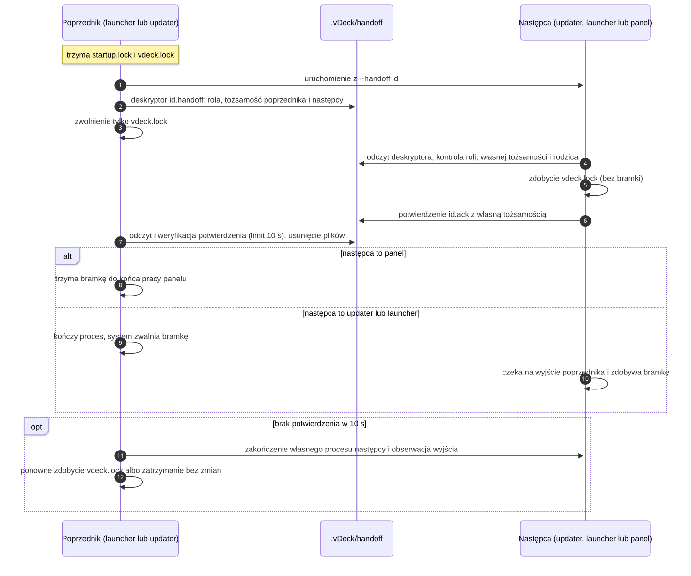

Źródło diagramu: [`diagramy/wspolne/przeplyw-przekazanie-blokady.mmd`](diagramy/wspolne/przeplyw-przekazanie-blokady.mmd)

**Transakcja updatera.** `VdeckUpdater` działa wyłącznie z `executor`, więc może podmienić zainstalowane
`jre` i `lib`. Po przejęciu blokad i bramki ponownie sprawdza serwer i kompletność `staged`, usuwa
backup poprzedniej aktualizacji, a `UpdatePlan` scala ustawienia do `update/merged` i liczy skróty.
`UpdateJournal` utrwala stan `PREPARED` przed pierwszą zmianą. `FileReplacer` dla katalogu wykonuje
rename instalacja → backup i staged → instalacja, a dla pliku trwałą kopię oryginału do backupu
i jeden atomowy rename nowej treści, więc BAT ani ustawienia nigdy nie znikają. Każdy krok zapisuje
zamiar przed akcją i potwierdzenie po niej. `COMMITTED` następuje po sprawdzeniu kompletu plików,
skrótów i wersji zainstalowanego launchera. Przy błędzie `UpdateRollback` cofa operacje od końca,
rozpoznając stan z rzeczywistych plików; jest idempotentny także po przerwaniu i nie usuwa pliku
o nieoczekiwanej tożsamości. Po stanie terminalnym updater przekazuje instalację zainstalowanemu
launcherowi z `--after-update`. Nieudany rollback albo nieczytelny dziennik zatrzymuje start
z instrukcją naprawy; dziennik i kopie zostają.

Plik z dziennikiem jest jedynym sygnałem dla `start-vDeck.bat`: jego istnienie uruchamia
`.vDeck\update\executor\jre\bin\java.exe -jar .vDeck\update\executor\vdeck-updater.jar --recover`,
więc recovery działa także bez zainstalowanego `jre` i `lib`. Wywołanie Javy w skrypcie jest jednym
blokiem zakończonym w tej samej linii `call exit /b %%^ERRORLEVEL%%`, dzięki czemu podmiana BAT-a
w trakcie działania jest bezpieczna.


Źródło diagramu: [`diagramy/wspolne/przeplyw-transakcja-aktualizacji.mmd`](diagramy/wspolne/przeplyw-transakcja-aktualizacji.mmd)

**Scalanie ustawień (AD-025).** `PropertiesMerger` traktuje szablon nowej wersji jako wzorzec: klucz obecny
w obu plikach zachowuje wartość użytkownika (także pustą), nowy klucz dostaje wartość domyślną,
klucz usunięty z szablonu znika. Komentarze i kolejność pochodzą z szablonu, wynik jest ASCII
(`\uXXXX`), a log zawiera tylko nazwy dodanych i usuniętych kluczy. `DistributionTemplatesTest`
i `StartSettingsTest` pilnują, by szablony `.dist` miały dokładnie klucze i wartości domyślne enumów.

**Logi uruchomień.** `LauncherMain` i `UpdaterMain` nie mają loggera: przed inicjalizacją Log4j2
tworzą plik `.vDeck/logs/launcher|updater/<rrrr-MM-dd>/<rrrr-MM-dd_HH-mm-ss>[-n].log` (`RunLogFile`)
i przekazują go przez `vdeck.log.file`. Plik zawiera angielski przebieg od `DEBUG`, konsola —
polskie komunikaty loggera `vdeck.console` (`UserConsole`). Kod przekazuje konsoli tylko klucz
(`ConsoleMessage`, `LauncherMessage`, `UpdaterMessage`), a `I18n` czyta tekst z
`vdeck-runtime/src/main/resources/console-messages.properties` i formatuje go przez `MessageFormat`
z polskim formatem liczb. Plik obraca się raz po 10 MiB, a
`RunLogRetention` usuwa dni starsze niż 30, dopiero po zdobyciu blokad. Gdy pliku nie da się
utworzyć, uruchomienie loguje tylko na konsolę.


Źródło diagramu: [`diagramy/wspolne/klasy-aktualizacja.mmd`](diagramy/wspolne/klasy-aktualizacja.mmd)

Ograniczenia: aktualizacja wymaga zatrzymanego panelu i serwera; paczka nie jest podpisana — zaufanie
opiera się na HTTPS, zapisanym w kodzie repozytorium i skrócie z API; kopia `update/backup` zajmuje
miejsce jednej wersji do następnej aktualizacji; ręczne cofnięcie nie cofa zmian bazy wykonanych
przez nową wersję; gwarancja dotyczy przerwania procesu, nie bezwarunkowej odporności na zanik zasilania.

---

## 2. Architektura aplikacji

`vdeck-app` jest modularnym monolitem z pionowymi feature slice'ami. Kod webowy, logika aplikacyjna
i persystencja jednej funkcji pozostają w jej podpakiecie.

### 2.1 Podział na pakiety

Bazowy pakiet to `com.github.pplociennik.vdeck`. Istnieją wyłącznie pakiety zawierające realny kod:

| Pakiet | Zawartość |
|---|---|
| `` (bazowy) | `VdeckApplication` — jedyny wyjątek od reguły umieszczania klas w podpakietach |
| `config` | Kompozycja kontekstu Springa: `PathConfiguration`, `SecurityConfiguration` oraz inicjalizacja startowa `SystemPropertiesInitializer` i `DataInitializer` |
| `feature.authentication` | Pionowy feature uwierzytelniania: kontrolery i ich `@ControllerAdvice`, `domain`, `dto`, `exc`, `persistence`, `service` i `service.impl` |
| `feature.home` | Strona główna panelu: `HomeController` |
| `feature.server` | Start serwera, walidacja, polecenie startowe, logi i udostępnienie stanu runtime widokom; wiring w `config.ServerRuntimeConfiguration` |
| `feature.launch` | Pionowy feature profilu uruchomieniowego: kontrolery ekranów „Serwer” i „Ustawienia gry” i ich `@ControllerAdvice`, `domain`, `dto`, `exc`, `service` i `service.impl`; bez `persistence`, bo profil leży w pliku ustawień (AD-013) |
| `feature.logs` | Konsola z logiem bieżącego uruchomienia serwera: `ConsoleController`, `dto.LogChunk`, `service` i `service.impl` |
| `security` | Przekrojowe filtry i handlery Spring Security, niezwiązane z jednym feature'em |
| `shared` | Infrastruktura bez logiki biznesowej: kontrakt ustawień, kontrakt kluczy tłumaczeń `TranslationKeyIf`, serwisy ścieżek i properties, wyjątki w `shared.exc`, domyślna obsługa wyjątków w `shared.web` |

Kontrakty serwisów znajdują się w pakiecie `service`, a implementacje w `service.impl`. Konsumenci
wstrzykują interfejs; klasy implementacyjne pozostają pakietowo-prywatne tam, gdzie to możliwe.

### 2.2 Start aplikacji

Start panelu jest procesem wieloetapowym: rozwiązanie katalogu instalacyjnego, aktualizacja schematu
bazy, przygotowanie plików ustawień i utworzenie konta domyślnego. Błąd rozwiązywania katalogu
bazowego przerywa start, zamiast pozwolić aplikacji działać z niepoprawną konfiguracją.

Pierwszym krokiem `VdeckApplication.main()` jest `feature.server.ServerExecutableCheck`. Sprawdza, czy
w katalogu instalacyjnym (`vdeck.server-directory`, a bez niego `ApplicationHome`) leży zwykły plik
`valheim_server.exe`. Jeżeli go nie ma, wypisuje komunikat `console.serverExecutableMissing` z
katalogiem i kończy proces kodem 1, zanim panel przejmie blokadę od launchera, więc launcher dopisuje
„Nie udało się uruchomić panelu vDeck.” i czeka na Enter. Logowanie nie jest jeszcze skonfigurowane,
dlatego komunikat trafia bezpośrednio na `System.out`. Sprawdzenie jest domyślnie włączone; wyłącza je
właściwość systemowa `-Dvdeck.server-file-check=false` (inna wartość go nie wyłącza), np. w IDE albo
przy zrzutach ekranu instrukcji przez `JAVA_TOOL_OPTIONS`, które dziedziczy także proces panelu.

Następnie `VdeckApplication.main()` oddaje start `shared.lock.InstallationLockService`, jedynemu miejscu obsługi
blokady panelu. Przy uruchomieniu przez launcher (`-Dvdeck.handoff=<id>`) serwis najpierw przejmuje
blokadę instalacji i rejestruje ją jako bean `installationLock`, którego właścicielem zostaje
`ManagedLaunchStore`; potem uruchamia wyłącznie Springa i zwalnia blokadę, gdy start się nie powiedzie. `config.ConsoleControlConfiguration`
tworzy bean `ConsoleControlSender`, który przy starcie nie tworzy procesu ani wątku oczekującego.
`ServerRuntimeConfiguration` wstrzykuje go do runtime. Osobny punkt wejścia helpera należy do
modułu runnera; jego kontrakt opisuje [5.9](#59-techniczny-helper-ctrlc).


Źródło diagramu: [`diagramy/wspolne/przeplyw-start-aplikacji.mmd`](diagramy/wspolne/przeplyw-start-aplikacji.mmd)

### 2.3 Obsługa wyjątków

Obowiązuje [`AD-014`](../.docs/architectural_decisions.md). Każdy główny proces panelu — zapis
profilu uruchomieniowego, start serwera i zmiana hasła — kończy się przy odrzuceniu **albo** niepowodzeniu własnym
wyjątkiem z podpakietu `exc` swojego feature'a. Serwisy nie zwracają obiektów wyniku, a kontrolery
nie sprawdzają wyniku ani nie przechwytują wyjątków; błąd walidacji adnotacji kontroler zgłasza tym
samym wyjątkiem procesu.

| Wyjątek procesu | Rzucany przez | Obsługuje | Co trafia do przekierowania |
|---|---|---|---|
| `feature.server.exc.ServerStartException` | `ServerStartValidator`, `ServerServiceImpl` | `ServerExceptionHandler` | klucz `ServerMessage` w `serverErrorKey`, zawsze na `/` |
| `feature.server.exc.ServerAdoptException` | `ServerServiceImpl` | `ServerExceptionHandler` | ADOPT_REJECTED lub ADOPT_FAILED w `serverErrorKey`, na `/` |
| `feature.launch.exc.LaunchProfileUpdateException` | `ServerSettingsController`, `GameSettingsController`, `LaunchProfileServiceImpl` | `LaunchProfileExceptionHandler` | klucz `LaunchProfileMessage` i przesłany formularz (ekranu „Serwer” zawsze bez hasła) |
| `feature.authentication.exc.PasswordChangeException` | oba kontrolery zmiany hasła, `PanelUserServiceImpl` | `PasswordChangeExceptionHandler` | wyłącznie klucz `PasswordChangeMessage` — formularz hasła jest zawsze pusty |

Wyjątek procesu niesie komunikat jako enum kluczy tłumaczeń, nigdy jako tekst. Odrzucenie przez regułę
nie ma przyczyny; niepowodzenie, np. nieudany zapis pliku, zachowuje ją jako `cause`. `@ControllerAdvice`
feature'a jest ograniczony do jego kontrolerów (`assignableTypes`) i ma pierwszeństwo przed obsługą
domyślną. Przekierowuje na ekran, który wysłał formularz, a komunikat i ewentualny formularz przekazuje
atrybutami flash, więc odświeżenie strony nie ponawia wysłania. Start serwera z dowolnej wyspy akcji
wraca zawsze na stronę główną. Kontroler przy `GET` wypełnia formularz
z zapisanego profilu tylko wtedy, gdy model nie zawiera już formularza przekazanego po odrzuceniu.

Każdy inny wyjątek, który opuści kontroler, trafia do `shared.web.DefaultExceptionHandler` o najniższym
priorytecie. Loguje go na poziomie `WARN` ze stack trace i odpowiada `500` przez `sendError`, więc
użytkownik widzi stronę błędu Spring Boota bez treści wyjątku. Dotyczy to każdego
`RuntimeException`, także wyjątku Spring MVC, który bez tej obsługi dostałby własny status — np.
niepoprawnego parametru żądania, odpowiadającego wtedy `500` zamiast `400`. Wyjątki kontrolowane
Spring MVC (np. brak zasobu, niedozwolona metoda HTTP) oraz wyjątki łańcucha filtrów Spring Security
do tej obsługi nie trafiają i zachowują swój status.

`catch` pozostaje tylko tam, gdzie zmienia znaczenie błędu, a nie tylko go loguje: przy zamianie
wyjątku technicznego na wyjątek procesu, przy zamianie `IOException` na `UncheckedIOException`, przy
sprzątaniu pliku tymczasowego oraz przy
odczycie wartości z pliku, która po ręcznej edycji nie jest liczbą i zostaje zastąpiona domyślną.


Źródło diagramu: [`diagramy/wspolne/przeplyw-obsluga-wyjatkow.mmd`](diagramy/wspolne/przeplyw-obsluga-wyjatkow.mmd)

---

## 3. Konfiguracja

### 3.1 Dwa kanały konfiguracji

Konfiguracja jest rozdzielona według właściciela:

| Kanał | Lokalizacja | Właściciel | Edytowalny przez użytkownika |
|---|---|---|---|
| `application.yaml` | wewnątrz jara | infrastruktura Spring Boot: datasource, JPA, adres serwera, ciasteczka sesji | nie |
| `vDeck.properties` | `.vDeck/config` w katalogu instalacyjnym | własne ustawienia panelu | tak |
| `valheim-server.properties` | `.vDeck/config` w katalogu instalacyjnym | profil uruchomieniowy serwera Valheim, patrz [5.6](#56-serwer-i-ustawienia-gry) | tak, także z panelu |

Wszystkie pliki ustawień leżą w podkatalogu `.vDeck/config` katalogu instalacyjnego (`AD-010`);
żaden nie leży bezpośrednio obok `vdeck.jar`. Plik `vDeck.properties` pozostawiony w katalogu
instalacyjnym przez wcześniejszą wersję deweloperską nie jest czytany ani przenoszony.

Bieżąca zawartość `application.yaml` obejmuje nazwę aplikacji, źródło danych SQLite
(`jdbc:sqlite:vdeck.db`), dialekt Hibernate `SQLiteDialect` z `ddl-auto: update`, zachowanie
`MessageSource` (`spring.messages.use-code-as-default-message`) oraz ustawienia serwera:
`port: 8085` i ciasteczko sesji z `http-only: true` i `same-site: lax`.

### 3.2 Ustawienia panelu w vDeck.properties

Zbiór ustawień pliku jest zamknięty i opisany typem wyliczeniowym implementującym `SystemPropertyIf`.
Dla pliku `vDeck.properties` jest to `VdeckProperty`:

| Klucz | Znaczenie | Obowiązkowe | Wartość domyślna |
|---|---|---|---|
| `game.log.directory` | Katalog dziennych podkatalogów logów gry, względny wobec instalacji | tak | `.vDeck/log` |
| `game.log.retention.enabled` | Czy przed startem usuwać stare logi gry; `false` zachowuje wszystkie logi, wartość inna niż `true`/`false` używa domyślnej | tak | `true` |
| `game.log.retention.days` | Nieujemna liczba dni retencji logów gry przy włączonej retencji; wartość ujemna lub nienumeryczna używa domyślnej | tak | `14` |
| `server.start.script` | Skrypt producenta czytany po `SteamAppId`, nigdy wykonywany przez panel | tak | `start_headless_server.bat` |
| `snapshot.directory` | Nazwa jednego podkatalogu `.vDeck` na snapshoty świata (AD-018); separator, `.` lub `..` przerywa start serwera | tak | `shutdown-snapshots` |
| `panel.game.settings.advanced` | Czy ekran „Ustawienia gry” pokazuje sekcję „Zaawansowane”; `true` albo `false` (patrz [5.6](#56-serwer-i-ustawienia-gry)) | tak | `false` |
| `panel.open.browser` | Czy panel uruchomiony skryptem startowym otwiera swój adres w domyślnej przeglądarce; `true` albo `false`, inna wartość używa domyślnej (patrz [1.7](#17-launcher-i-automatyczna-aktualizacja)) | tak | `true` |

Każde ustawienie deklaruje przez `SystemPropertyIf.isMandatory()`, czy jest obowiązkowe. Wartość
flagi podaje konstruktor enuma, obok klucza i wartości domyślnej. Ustawienie obowiązkowe ma zawsze
niepustą wartość; opcjonalne może być puste, a pusta wartość oznacza, że ustawienie nie jest używane.

Wszystkie pliki ustawień obsługuje jeden bean `SystemPropertiesService` (`AD-013`). Każda operacja —
`getValue`, `setValue`, `setValues` — przyjmuje nazwę pliku, czyli stałą `FILE_NAME` jego enuma.
`SystemPropertiesServiceImpl` trzyma wczytane pliki w mapie według nazwy, po jednym `PropertiesFile`
na plik. Zestaw wartości — domyślnych przy `loadFile` albo zapisywanych razem przez `setValues` —
przekazuje obiekt `SystemPropertyValues` (`shared`), a nie luźna mapa. Tworzy go `create()`, wpisy
dodaje łańcuchowo `with( ustawienie, wartość )`, a `asMap()` zwraca je tylko do odczytu, w kolejności
dodania. Każde wywołanie buduje nowy obiekt, więc wpisy jednego zapisu nie trafiają do innego; ponowne
podanie tego samego ustawienia kończy się `IllegalArgumentException`, a obiekt celowo nie ma
`toString` ujawniającego wartości, bo wśród nich może być hasło serwera.

Wartości typowane odczytuje statyczne narzędzie `shared.PropertyReader`, któremu wywołujący podaje
serwis, nazwę pliku, ustawienie i wartość zastępczą: `read` zwraca wartość bez zmian, `readInt` liczbę,
`readBoolean` wyłącznie `true` albo `false` w dowolnej wielkości liter, a `readOptional` wartość
ustawienia opcjonalnego zinterpretowaną przez podany parser — pusta oznacza „nie używaj”, a
nierozpoznana jest pomijana. Wartość niepasująca do ustawienia daje wartość zastępczą i wpis `WARN`
z nazwą ustawienia i pliku, nigdy z samą wartością; odczyt nie przepisuje pliku.

Zasady obsługi plików:

- plik trzeba najpierw wczytać przez `loadFile( nazwaPliku, wartościDomyślne )`; lokalizację wyznacza
  `PathService.getConfigurationFile`; ponowne wczytanie tego samego pliku oraz odwołanie do pliku
  niewczytanego kończą się `IllegalStateException`;
- wszystkie pliki wczytuje przy starcie `SystemPropertiesInitializer` (`config`,
  `SmartInitializingSingleton`) — po utworzeniu wszystkich beanów, ale zanim serwer WWW przyjmie
  pierwsze żądanie; błąd wczytania przerywa start;
- plik jest wczytywany **raz** i utrzymywany w pamięci; ręczna edycja pliku przy działającym panelu
  zostanie uwzględniona dopiero po restarcie;
- brakujący plik jest tworzony z wartościami domyślnymi razem z brakującymi katalogami nadrzędnymi;
- brakujący klucz jest przywracany do wartości domyślnej i zapisywany — to jednocześnie ścieżka
  migracji ustawień dodanych w nowej wersji; pusta wartość jest zastępowana domyślną tylko dla
  ustawienia obowiązkowego, a ustawienie opcjonalne zachowuje ją;
- obowiązkowe ustawienie z pustą wartością domyślną jest odrzucane już przy wczytaniu, a zapis
  pustej wartości ustawienia obowiązkowego kończy się `IllegalArgumentException`;
- wpisy nienależące do zbioru zarządzanego są zachowywane, ale komentarze i kolejność kluczy przepadają
  przy pierwszym zapisie pliku przez aplikację;
- `getValue` jest zwykłym odczytem z pamięci i nigdy nie zwraca `null`;
- `setValues` zmienia wiele ustawień naraz: najpierw sprawdza wszystkie wpisy, potem zapisuje plik
  **jeden raz** — zmieniają się wszystkie wartości albo żadna;
- zapis jest atomowy: dane trafiają do pliku tymczasowego, są wypychane na urządzenie (`FileChannel.force`),
  a następnie podmieniane przez `ATOMIC_MOVE`; nowy zestaw jest publikowany w pamięci po udanym zapisie,
  więc pamięć i dysk nie mogą się rozjechać;
- do logu trafiają wyłącznie nazwy kluczy i ich liczba, nigdy wartości, ponieważ plik ustawień może
  zawierać sekrety.

### 3.3 Rozwiązywanie ścieżek

`PathService` jest jedynym komponentem zamieniającym skonfigurowany tekst na `Path`, dzięki czemu
normalizacja i kontrola zasięgu obowiązują w całym panelu. Stały zewnętrzny katalog snapshotów
jest osobnym wyjątkiem AD-018: rozwiązuje go `BackupPathService`, opisany w [5.10](#510-zatrzymanie-snapshoty-i-odzyskiwanie).

Katalog bazowy (instalacyjny) to katalog zawierający `valheim_server.exe`. Jest brany z
`ApplicationHome`, chyba że ustawiono override `vdeck.server-directory`. Skrypt dystrybucji zawsze
go ustawia, ponieważ JAR-y leżą w podkatalogu `lib`. Rozwiązanie następuje raz,
podczas konstrukcji, więc błędna konfiguracja przerywa start panelu.

`getAbsolutePath( String )` odrzuca wartość, która:

- jest pusta lub złożona wyłącznie z białych znaków — `IllegalArgumentException`;
- jest ścieżką bezwzględną lub składniowo niepoprawną — `PathResolutionException`;
- wychodzi poza katalog instalacyjny bezpośrednio, przez segmenty `..`, przez dowiązanie symboliczne
  albo junction systemu Windows — `PathResolutionException`.

Gdy cel już istnieje, zwracana jest jego postać rzeczywista (`toRealPath`) i ponownie sprawdzany jest
zasięg. Metoda nigdy nie tworzy plików ani katalogów, więc zwrócona ścieżka może jeszcze nie istnieć.

`getConfigurationFile( String )` jest jedynym sposobem wyznaczenia lokalizacji pliku ustawień.
Przyjmuje samą nazwę pliku — nazwę z separatorem katalogów, `.` albo `..` odrzuca wyjątkiem
`PathResolutionException` — i rozwiązuje ją w katalogu `PathService.CONFIGURATION_DIRECTORY`
(`.vDeck/config`) przez `getAbsolutePath`, więc obowiązują te same kontrole zasięgu.

### 3.4 Komponenty konfiguracji


Źródło diagramu: [`diagramy/wspolne/klasy-konfiguracja.mmd`](diagramy/wspolne/klasy-konfiguracja.mmd)

Dodanie kolejnego pliku ustawień polega na utworzeniu nowego typu wyliczeniowego implementującego
`SystemPropertyIf` ze stałą `FILE_NAME` i dopisaniu wywołania `loadFile` w
`SystemPropertiesInitializer`. Nie powstaje nowy bean ani kwalifikator: konsument wstrzykuje ten sam
`SystemPropertiesService` i podaje nazwę pliku w każdym wywołaniu. `SystemPropertyIf` celowo niesie tylko klucz i flagę obowiązkowości —
wartość domyślna i plik właściciela należą do konkretnego enuma.

### 3.5 Tłumaczenia interfejsu

Interfejs jest w języku polskim, ale wszystkie teksty przechodzą przez mechanizm tłumaczeń Springa
(patrz [`AD-009`](../.docs/architectural_decisions.md)). Teksty nie są kanałem ustawień z
[3.1](#31-dwa-kanały-konfiguracji) ani zasobem zewnętrznym — są częścią aplikacji.

| Element | Wartość |
|---|---|
| Plik | `vdeck-app/src/main/resources/messages.properties` |
| Źródło | Classpath aplikacji, przez domyślny `MessageSource` Spring Boota |
| Zapis znaków | Czysto ASCII — polskie znaki jako sekwencje `\uXXXX` |
| Konfiguracja | `spring.messages.use-code-as-default-message: true` w `application.yaml` |

Zachowanie:

- Panel ma jeden język, więc nie istnieje plik `messages_<język>.properties`, katalog tłumaczeń w
  instalacji ani własna klasa `@Configuration` tworząca `MessageSource`. Bundle rozwiązuje się dla
  każdego locale, ponieważ plik bazowy nie ma sufiksu językowego.
- Klucz bez tłumaczenia renderuje się jako sam klucz — widoczna usterka tekstu jest bezpieczniejsza
  niż błąd całej strony.
- Zmiana albo dodanie tekstu jest zmianą w repozytorium i wymaga nowego wydania panelu.
- Kod Javy nigdy nie przekazuje gotowego tekstu, tylko klucz; zamknięte zbiory komunikatów opisują
  typy wyliczeniowe implementujące `TranslationKeyIf`, jak `PasswordChangeMessage`.

---

## 4. Uwierzytelnianie i dostęp do panelu

### 4.1 Zakres funkcjonalności

Feature `authentication` chroni cały panel: każde żądanie wymaga uwierzytelnienia, a konto tworzone
przy pierwszym starcie nie daje dostępu do panelu, dopóki jego hasło początkowe nie zostanie zmienione.

Widoczne zachowanie:

| Adres | Metoda | Dostęp | Efekt |
|---|---|---|---|
| `/login` | GET, POST | publiczny | Formularz logowania generowany przez Spring Security |
| `/initial-password-change` | GET | uprawnienie `PASSWORD_CHANGE_REQUIRED` | Formularz wymuszonej zmiany hasła początkowego, bez pola aktualnego hasła |
| `/initial-password-change` | POST | uprawnienie `PASSWORD_CHANGE_REQUIRED` | Zmiana hasła i wylogowanie albo ponowny formularz z komunikatem |
| `/change-password` | GET | rola `ADMIN` | Formularz zmiany hasła na życzenie, z polem aktualnego hasła i wyspą akcji |
| `/change-password` | POST | rola `ADMIN` | Zmiana hasła i wylogowanie albo ponowny formularz z komunikatem |
| `/` | GET | rola `ADMIN` | Strona główna panelu |
| `/logout` | POST | uwierzytelniony | Domyślne wylogowanie Spring Security |
| `/css/**`, `/icons/**`, `/img/**` | GET | rola `ADMIN` | Zasoby statyczne interfejsu; osiągalne także przed zmianą hasła początkowego |
| `/js/**` | GET | rola `ADMIN` | Moduły JavaScript interfejsu; nieosiągalne przed zmianą hasła początkowego, bo ekran wymuszonej zmiany nie używa skryptów |
| pozostałe | dowolna | rola `ADMIN` | Dostęp do panelu |

Zmiana hasła ma **dwa osobne ekrany**, bo są to dwie różne operacje. Wymuszona zmiana hasła
początkowego nie pyta o aktualne hasło — konto używa opublikowanego hasła domyślnego, którego
użytkownik nigdy nie wybierał — i dlatego jej adres jest zarezerwowany dla kont z uprawnieniem
`PASSWORD_CHANGE_REQUIRED`. Zmiana na życzenie, uruchamiana z wyspy akcji w dowolnym momencie, wymaga
podania aktualnego hasła i jest dostępna dla każdego konta z rolą `ADMIN`. Konto przed zmianą hasła
początkowego nie może otworzyć tego drugiego ekranu — filtr odsyła je na ekran wymuszony.

Panel nie ma na tym etapie własnej strony logowania — używana jest strona generowana przez Spring
Security. Własne widoki Thymeleaf osiągalne pod adresem to `authentication/change-password`,
`authentication/initial-password-change` oraz `home/index`; opisuje je sekcja
[5. Warstwa interfejsu użytkownika](#5-warstwa-interfejsu-użytkownika).

### 4.2 Model danych

Encja `PanelUser` (tabela `panel_users`) przechowuje komplet stanu logowania:

| Kolumna | Typ | Uwagi |
|---|---|---|
| `username` | `VARCHAR(64)`, klucz główny | Niemodyfikowalna nazwa logowania |
| `password_hash` | `VARCHAR(255)`, niepusty | Jednokierunkowy hash adaptacyjny wraz z identyfikatorem enkodera |
| `role` | `VARCHAR(32)`, niepusty | `PanelRole` zapisany jako `STRING`; obecnie wyłącznie `ADMIN` |
| `password_change_required` | `BOOLEAN`, niepusty | Znacznik konieczności zmiany hasła początkowego |

Encja waliduje własne niezmienniki w konstruktorze: `username` i `passwordHash` nie mogą być puste ani
złożone z białych znaków, a `role` nie może być `null`. Zmiana hasła przechodzi wyłącznie przez metodę
`changePassword( String )`, która ustawia nowy hash **i** zdejmuje znacznik `passwordChangeRequired` —
oba stany nie mogą się rozjechać. Hasło jawne nie jest nigdzie przechowywane; nośnik `PasswordChangeRequest`
nadpisuje `toString()` stałym tekstem z zamaskowanymi polami.

### 4.3 Domyślne konto administratora

`DataInitializer` jest `CommandLineRunner` uruchamianym po starcie kontekstu. Gdy nie istnieje konto o
nazwie `admin`, tworzy konto:

- nazwa: `admin`;
- hasło początkowe: `admin`, zapisane wyłącznie jako hash z `PasswordEncoder`;
- rola: `ADMIN`;
- `passwordChangeRequired`: `true`.

Inicjalizacja jest idempotentna — istniejące rekordy nigdy nie są nadpisywane, więc kolejne starty nie
resetują zmienionego hasła. Błąd zapisu jest propagowany, aby aplikacja nie wystartowała bez zdatnych
poświadczeń.

### 4.4 Logowanie

`PanelUserServiceImpl.loadUserByUsername` ładuje konto i buduje `UserDetails`. Do uprawnień trafia
`ROLE_` + nazwa roli, a gdy konto ma znacznik zmiany hasła — dodatkowo uprawnienie techniczne
`PASSWORD_CHANGE_REQUIRED`. To uprawnienie jest jedynym nośnikiem ograniczenia pierwszego logowania:
odczytują je zarówno handler sukcesu logowania, jak i filtr żądań, dzięki czemu ograniczenie działa
także dla sesji nawiązanej przed zmianą hasła.

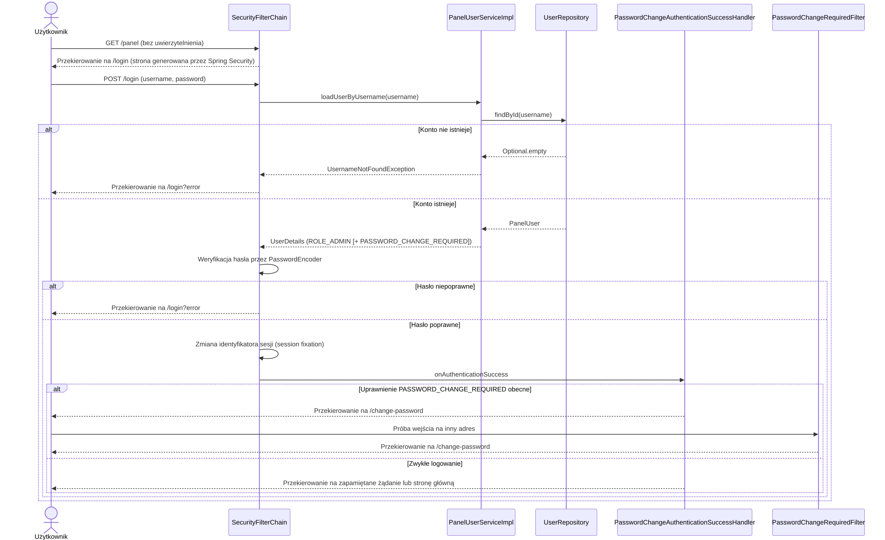

Źródło diagramu: [`diagramy/authentication/przeplyw-logowanie.mmd`](diagramy/authentication/przeplyw-logowanie.mmd)

`PasswordChangeAuthenticationSuccessHandler` przekierowuje konto z ograniczeniem prosto na
`/initial-password-change`, a pozostałe logowania deleguje do
`SavedRequestAwareAuthenticationSuccessHandler`, więc po zwykłym zalogowaniu użytkownik wraca do
adresu, o który pierwotnie prosił, a przy braku zapamiętanego żądania trafia na stronę główną `/`.

`PasswordChangeRequiredFilter` jest wpięty za `UsernamePasswordAuthenticationFilter` i działa raz na
żądanie. Dla konta z uprawnieniem `PASSWORD_CHANGE_REQUIRED` dopuszcza:

- dokładne ścieżki `/initial-password-change` i `/logout`;
- żądania zaczynające się od `/css/`, `/icons/` albo `/img/`, czyli zasoby statyczne, bez których
  ekran zmiany hasła nie ma stylów, ikon ani tekstur.

Ekran `/change-password` **nie** jest na tej liście: pytałby o aktualne hasło, którego konto z hasłem
początkowym nigdy nie wybierało. Każde inne żądanie kończy się przekierowaniem na
`/initial-password-change`. Dopasowanie zasobów działa
wyłącznie na początku ścieżki, więc adres panelu zawierający katalog zasobów w dalszej części
(`/servers/css/list`) pozostaje zablokowany, a wyjątek nie omija reguł autoryzacji łańcucha
bezpieczeństwa — zasoby nadal wymagają roli `ADMIN`.

### 4.5 Zmiana hasła

Zmiana hasła ma dwa warianty, obsługiwane przez osobne kontrolery i osobne operacje serwisu:

| Wariant | Adres i kontroler | Operacja serwisu | Nośnik żądania | Pyta o aktualne hasło | Wyspa akcji |
|---|---|---|---|---|---|
| Wymuszona zmiana hasła początkowego | `/initial-password-change`, `InitialPasswordChangeController` | `changeInitialPassword` | `InitialPasswordChangeRequest` | nie | nie |
| Zmiana na życzenie | `/change-password`, `PasswordChangeController` | `changePassword` | `PasswordChangeRequest` | tak | tak |

Walidacja adnotacjami (`@NotBlank`, `@Size(min = 12, max = 128)` dla nowego hasła i potwierdzenia)
odrzuca wejście przed sięgnięciem do bazy. Dalsze kontrole wykonuje `PanelUserServiceImpl`, a pierwsza
nieudana kontrola kończy operację:

1. **tylko wariant na życzenie** — zgodność aktualnego hasła z zapisanym hashem;
2. **tylko wariant wymuszony** — czy konto nadal ma znacznik `passwordChangeRequired`; jego brak
   oznacza, że hasło zostało już wybrane, więc pominięcie kontroli aktualnego hasła przestaje być
   dopuszczalne i operacja kończy się `IllegalStateException`;
3. zgodność nowego hasła z potwierdzeniem;
4. różnicę względem aktualnego hasła;
5. wymagany zestaw rodzajów znaków — cyfrę, małą literę, wielką literę oraz znak specjalny, czyli
   znak niebędący literą, cyfrą ani białym znakiem.

Po każdym niepowodzeniu użytkownik wraca na ten sam ekran z **pustymi** polami i pojedynczym
komunikatem; komunikaty nie zdradzają, który element poświadczeń był niepoprawny bardziej, niż wymaga
tego obsługa błędu.

Odrzucona zmiana kończy się `PasswordChangeException`, który niesie **klucz komunikatu do pokazania**
(patrz [2.3](#23-obsługa-wyjątków)). Dzięki temu kontroler nie tłumaczy wyniku na własne brzmienie i oba
ekrany opisują to samo odrzucenie identycznie. Udana zmiana kończy się bez wyjątku.

| Warunek odrzucenia | Klucz komunikatu w `PasswordChangeException` |
|---|---|
| Pole puste albo nowe hasło spoza 12–128 znaków (walidacja adnotacji w kontrolerze) | `PasswordChangeMessage.INVALID_INPUT` |
| Aktualne hasło nie pasuje do zapisanego hasha (tylko wariant na życzenie) | `PasswordChangeMessage.CURRENT_PASSWORD_INCORRECT` |
| Nowe hasło różni się od potwierdzenia | `PasswordChangeMessage.NEW_PASSWORD_MISMATCH` |
| Nowe hasło jest identyczne z aktualnym | `PasswordChangeMessage.NEW_PASSWORD_UNCHANGED` |
| Nowe hasło nie zawiera cyfry, małej litery, wielkiej litery i znaku specjalnego | `PasswordChangeMessage.NEW_PASSWORD_TOO_WEAK` |

`PasswordChangeExceptionHandler` przekierowuje na ekran, który wysłał formularz, i przekazuje atrybutem
flash wyłącznie klucz tłumaczenia (`passwordChangeErrorKey`); brzmienie komunikatu pochodzi z pliku
tłumaczeń opisanego w [3.5](#35-tłumaczenia-interfejsu). Formularz nie jest przekazywany, więc
wpisane hasło nigdy nie wraca do przeglądarki. `IllegalStateException` wariantu wymuszonego obsługuje
`DefaultExceptionHandler`, a `UsernameNotFoundException` — Spring Security.


Źródło diagramu: [`diagramy/authentication/przeplyw-zmiana-hasla.mmd`](diagramy/authentication/przeplyw-zmiana-hasla.mmd)

Po sukcesie — w obu wariantach — sesja jest unieważniana, a kontekst bezpieczeństwa czyszczony, więc
użytkownik musi zalogować się nowym hasłem. Po wymuszonej zmianie uprawnienie
`PASSWORD_CHANGE_REQUIRED` nie pojawi się już przy kolejnym załadowaniu konta.

### 4.6 Sesje i wylogowanie

`SecurityConfiguration` ustawia:

- `sessionFixation().changeSessionId()` — identyfikator sesji jest zmieniany po zalogowaniu;
- `maximumSessions( 1 )` z `maxSessionsPreventsLogin( false )` — nowe logowanie unieważnia poprzednią
  sesję zamiast blokować logowanie; wygasła sesja trafia na `/login?expired`;
- `HttpSessionEventPublisher` — wymagany, aby kontrola równoległych sesji widziała zakończone sesje;
- domyślne wylogowanie Spring Security (`POST /logout`).

Ciasteczko sesji jest `HttpOnly` i `SameSite=Lax` (`application.yaml`). Ochrona CSRF pozostaje w
domyślnej, włączonej konfiguracji Spring Security.

### 4.7 Komponenty feature'a


Źródło diagramu: [`diagramy/authentication/klasy-komponenty.mmd`](diagramy/authentication/klasy-komponenty.mmd)

Filtr i handler bezpieczeństwa leżą w przekrojowym pakiecie `security`, a nie w feature'rze, ponieważ
dotyczą każdego żądania do panelu. `DataInitializer` należy do `config`, mimo że wstrzykuje repozytorium
uwierzytelniania, ponieważ jest elementem inicjalizacji startowej aplikacji.

`PasswordChangeException` należy do `exc`, a `PasswordChangeMessage` i `PasswordChangeExceptionHandler`
— do korzenia feature'a: komunikaty zawierają również `INVALID_INPUT`, komunikat walidacji warstwy
webowej, którego serwis nigdy nie zgłasza, a advice musi widzieć pakietowo-prywatne kontrolery, które
obsługuje.

---

## 5. Warstwa interfejsu użytkownika

Reguły obowiązujące przy budowie interfejsu opisuje [`.docs/ui.md`](../.docs/ui.md); ta sekcja opisuje
wyłącznie stan zaimplementowany. Interfejs jest budowany z szablonów Thymeleaf i arkuszy CSS oraz
natywnych modułów ES bez procesu budowania frontendu i bez zależności od CDN — panel wyświetla się
w całości z zasobów wbudowanych w aplikację. Moduły są dwa: `side-menu.js` steruje menu bocznym,
a `game-settings.js` pokazuje i ukrywa sekcję „Zaawansowane” ekranu „Ustawienia gry”, zapamiętując
wybór. Formularze obu ekranów ustawień zapisują się bez JavaScriptu.

### 5.1 Zasoby statyczne i arkusze stylów

```text
vdeck-app/src/main/resources/
├── static/
│   ├── css/
│   │   ├── variables.css        ← wszystkie zmienne CSS panelu
│   │   └── base.css             ← baza dokumentu, layout, karta widoku, formularze, panele ustawień, komponenty wspólne
│   ├── icons/icons.svg          ← jeden sprite ze wszystkimi ikonami
│   ├── img/                     ← page-, config-, panel-, island- i side-menu-background.jpg
│   └── js/
│       ├── side-menu.js         ← zachowanie menu bocznego
│       └── game-settings.js     ← sekcja „Zaawansowane” ekranu „Ustawienia gry”
├── messages.properties          ← polski zestaw tekstów interfejsu
└── templates/
    ├── common/home-button.html     ← komponent wspólny: przycisk strony głównej
    ├── common/island.html          ← komponent wspólny: wyspa akcji
    ├── common/password-rules.html  ← komponent wspólny: wymagania dla nowego hasła
    ├── common/side-menu.html       ← komponent wspólny: menu boczne
    ├── home/index.html             ← strona główna panelu
    ├── launch/server-settings.html ← ekran „Serwer”
    ├── launch/game-settings.html   ← ekran „Ustawienia gry”
    ├── authentication/change-password.html
    └── authentication/initial-password-change.html
```

- `variables.css` jest jedynym miejscem definicji zmiennych CSS. Każdy pozostały arkusz zaczyna się
  od `@import url("variables.css")` i nie definiuje własnych tokenów.
- `base.css` zawiera bazę dokumentu, wyśrodkowanie widoku (`.page-center`), wspólną powierzchnię
  z ramą i teksturą (`.surface`), kontrakt ikony (`.icon`), style komponentów wspólnych oraz kartę
  widoku i kontrolki formularzy używane przez kilka ekranów: `.view-card` z nagłówkiem
  (`.view-header`, `.view-title`, `.view-lead`), komunikaty `.form-alert` i `.form-success`, sekcje
  `.form-section` z tytułem na linii, pola `.form-field`, `.form-input`, `.form-select`,
  `.form-checkbox`, opis pola `.form-hint` i przycisk `.form-submit`. Zawiera też układ paneli
  ustawień wspólny dla ekranów „Serwer” i „Ustawienia gry” (`AD-012`): szeroką kartę
  `.view-card--wide`, formularz `.settings-form` z wariantem kolumnowym `.settings-form--columns`,
  kolumny `.settings-column`, siatkę pól `.settings-fields`, wyśrodkowany komunikat
  `.settings-message`, stopkę z przyciskiem `.settings-footer` i przełącznik sekcji zaawansowanej
  `.settings-advanced-toggle`. Globalna reguła `[hidden]` gwarantuje, że atrybut `hidden` ukrywa
  element także wtedy, gdy jego klasa ustawia `display`. Arkusz widoku zawierałby wyłącznie układ
  właściwy jednemu ekranowi — obecnie żaden widok go nie potrzebuje.
- Każdy panel — karta ekranu hasła albo ekranu ustawień — jest owinięty w ramę `.panel-frame`
  o stałej wysokości 70 % widoku (`--panel-frame-block-size`), wyśrodkowaną w miejscu pod wyspą;
  nad panelem i pod nim zostaje wolne miejsce, a wszystkie panele mają tę samą wysokość. Karta
  wypełnia ramę i przewija treść wewnątrz, z cienkim paskiem przewijania w kolorze akcentu. Gdy widok
  jest niższy niż rama, np. telefon w poziomie, rama kurczy się do dostępnego miejsca.
- Karta panelu pod wyspą ma od dołu zapas na pływający przycisk menu bocznego, więc ostatni element,
  zwykle przycisk formularza, da się przewinąć ponad przycisk menu.
- Interfejs używa pięciu tekstur: `page-background.jpg` na tle strony, `config-background.jpg` na
  panelach, `panel-background.jpg` na kartach obu ekranów hasła, `island-background.jpg` na wyspie
  akcji oraz `side-menu-background.jpg` w menu bocznym. Panel jest przypadkiem domyślnym: `.surface`
  ustawia teksturę panelu, a powierzchnia o innej teksturze nadpisuje wyłącznie lokalną właściwość
  `--surface-texture` — robią to modyfikatory `.surface--island`, `.surface--side-menu` i
  `.surface--password`.
- Kontrolki — przyciski i pola formularza — mają jednolicie czarne tło, więc odcinają się od tekstury
  zamiast jej prześwitywać. Stan wyróżnia jasność tła (`hover`), obramowanie akcentem (`focus`) oraz
  przygaszona ikona lub etykieta (`disabled`); wyłączona kontrolka nie jest wygaszana przezroczystością,
  bo pokazałaby wtedy teksturę pod spodem.
- Tło strony to tekstura `page-background.jpg` przyciemniona winietą. Obie warstwy są rysowane
  w jednym stałym elemencie za treścią, bez `background-attachment: fixed`, którego przeglądarki
  mobilne nie renderują stabilnie.
- Układ jest responsywny w obu orientacjach: wysokości pełnoekranowe liczone są w `dvh`, obszary
  dotykowe mają co najmniej 44 × 44 px, a przy szerokości poniżej 33 rem wyspa zawija grupy akcji.
- **Strona nie przewija się w żadnej osi.** `body` jest powłoką o wysokości jednego widoku
  (`100dvh`, `overflow: hidden`); wyspa zajmuje swoją wysokość, a obszar treści (`.page-content`)
  bierze resztę. Gdy widok nie mieści się w bardzo niskim oknie, układ najpierw oddaje odstępy
  dekoracyjne, a dopiero potem przewija się karta panelu wewnątrz swojej ramy — nigdy strona.

### 5.2 Wyspa akcji

Wyspa jest komponentem wspólnym — plik `templates/common/island.html` z fragmentem `island`, który
widok osadza przez `th:replace="~{common/island :: island}"`. Jest to pasek nagłówka wyśrodkowany
w poziomie u góry strony, o zaokrąglonych rogach, grubej czarnej ramie, teksturze
`island-background.jpg` i wysokości nieprzekraczającej 100 px.

Wyspa dzieli się na trzy grupy akcji rozdzielone pionowymi liniami o wysokości 80 % wyspy:

| Grupa | Szerokość | Akcje | Stan |
|---|---|---|---|
| Sterowanie serwerem | najszersza | start, zatrzymanie, restart, wymuszone zatrzymanie | Start: `POST /server/start`; Stop: `POST /server/stop`; Kill: potwierdzenie i `POST /server/kill`; Restart pozostaje bez akcji |
| Kopie bezpieczeństwa | nieco węższa | utworzenie kopii świata, utworzenie kopii serwera | Przyciski bez akcji — funkcjonalność nie jest zaimplementowana |
| Zarządzanie panelem | wąska | zmiana hasła, wylogowanie | Działa: odnośnik do `/change-password` oraz formularz `POST /logout` obsługiwany przez domyślne wylogowanie Spring Security |

Przyciski są kwadratowe i zawierają wyłącznie ikonę, więc każdy ma `aria-label` z nazwą akcji.
Na wąskich ekranach grupy zawijają się do kolejnych wierszy, a separatory — które nie leżałyby już
między sąsiadami — są ukrywane.

Nad wyspą wyrasta zakładka z nazwą serwera (`island-name`) — lustrzane odbicie znacznika stanu:
trapez zwężający się ku górze, o tej samej wysokości, tle i kroju, ale szeroki na 80 % wyspy, z nazwą
wyśrodkowaną i skracaną wielokropkiem (pełna nazwa w `title`). Nazwę (`serverName`) dostarcza
`ServerStatusAdvice` z opublikowanego profilu uruchomienia (`LaunchProfileService.getProfile()`), więc
zapisana zmiana na ekranie „Serwer” pojawia się przy następnym renderowaniu.

Pod wyspą znajduje się znacznik stanu (`island-status`). `ServerStatusAdvice` dostarcza aktualny
`serverStatus` przy każdym renderowaniu. Start jest dostępny tylko w STOPPED, START_FAILED i CRASHED;
Stop i Kill tylko w RUNNING lub STOP_FAILED. `server-status.js` co 2 sekundy pobiera fragment
`GET /server/status`, gdy strona jest widoczna. Jedno żądanie naraz, timeout 5 s i zachowanie
poprzedniego widoku przy błędzie; aktywny fokus w wyspie zapobiega utracie fokusu przy wymianie.

Formularze Start, Stop, Kill i wylogowania korzystają z `th:action`, więc Thymeleaf dokłada do nich ukryty token CSRF
wymagany przez łańcuch bezpieczeństwa. Wyspa nie jest osadzana na ekranie wymuszonej zmiany hasła
początkowego — konto przed zmianą hasła nie może wykonać żadnej z jej akcji.

### 5.3 Ikony

Wszystkie ikony pochodzą z jednego lokalnego sprite'a `/icons/icons.svg` i są osadzane przez `<use>`.
Symbole są monochromatyczne i dziedziczą kolor komponentu przez `currentColor`; sprite zawiera
`icon-play`, `icon-stop`, `icon-restart`, `icon-power`, `icon-world-backup`, `icon-server-backup`,
`icon-key`, `icon-logout`, `icon-home` (przycisk strony głównej), `icon-menu` (przycisk menu bocznego), `icon-server` (ekran „Serwer”),
`icon-sliders` (ekran „Ustawienia gry”), `icon-console` (ekran „Konsola”) i `icon-chevron` (stan gałęzi menu). Obie ikony kopii bezpieczeństwa mają ten sam znacznik duplikatu, ponieważ
przyciski tworzą kopię, a nie pobierają pliku.

Sprite musi być osiągalny również na ekranie wymuszonej zmiany hasła, dlatego
`PasswordChangeRequiredFilter` przepuszcza katalogi zasobów statycznych (patrz [4.4](#44-logowanie)).

### 5.4 Ekrany panelu

- **Strona główna** (`home/index.html`, `HomeController`, adres `/`) osadza wyspę akcji nad pustym
  obszarem treści oraz menu boczne. Pokazuje komunikaty sterowania serwerem i minimalną opcję jawnej adopcji
  po restarcie panelu, kiedy istnieje pasujący token uruchomienia.
- **Wymuszona zmiana hasła początkowego** (`authentication/initial-password-change.html`) to
  wyśrodkowana karta na wspólnej powierzchni `.surface`, **bez wyspy, bez menu bocznego i bez
  jakiejkolwiek innej akcji**: nagłówek z ikoną klucza, opis, opcjonalny komunikat błędu z `role="alert"` oraz formularz
  dwóch pól hasła — nowego i potwierdzenia — z przyciskiem wysłania.
- **Zmiana hasła na życzenie** (`authentication/change-password.html`) to ta sama karta osadzona pod
  wyspą akcji, w zwykłym obszarze treści, uzupełniona o pole aktualnego hasła; ekran ma też menu
  boczne.
- Oba ekrany hasła osadzają komponent wspólny `common/password-rules.html` z wymaganiami
  egzekwowanymi przez serwer — długość 12–128 znaków, cyfra, mała litera, wielka litera, znak
  specjalny, różnica względem aktualnego hasła i zgodność obu pól — powiązany z polem nowego hasła
  przez `aria-describedby`. Pola mają rozmiar tekstu 1 rem, aby przeglądarki mobilne nie przybliżały
  widoku po ustawieniu fokusu.
- **Serwer** (`launch/server-settings.html`, adres `/server-settings`) i **Ustawienia gry**
  (`launch/game-settings.html`, adres `/game-settings`) to szerokie karty z domyślną teksturą panelu,
  osadzone pod wyspą akcji, z menu bocznym — opisane w [5.6](#56-serwer-i-ustawienia-gry).
- **Konsola** (`logs/console.html`, adres `/console`) to szeroka karta pod wyspą akcji, z menu
  bocznym, wypełniona przewijanym oknem logu serwera — opisana w [5.11](#511-konsola).
- **Logowanie** korzysta ze strony generowanej przez Spring Security — nie jest ani stylowane, ani
  tłumaczone, więc pozostaje w języku angielskim.

Żaden szablon nie zawiera tekstu wpisanego na stałe: teksty, tytuły stron oraz atrybuty `aria-label`
i `title` pochodzą z tłumaczeń opisanych w [3.5](#35-tłumaczenia-interfejsu).

### 5.5 Menu boczne

Menu boczne jest komponentem wspólnym — plik `templates/common/side-menu.html` z fragmentem
`sideMenu`, osadzanym przez `th:replace="~{common/side-menu :: sideMenu}"` na stronie głównej, na
ekranie zmiany hasła na życzenie oraz na ekranach „Serwer”, „Ustawienia gry” i „Konsola”. Widok otwierany z menu
przekazuje identyfikator swojej pozycji — np. `~{common/side-menu :: sideMenu(activeEntry='gameSettings')}` —
dzięki czemu pozycja jest oznaczona jako bieżąca strona. Fragment dołącza własny moduł
`/js/side-menu.js`, więc widok nie musi o nim pamiętać; style leżą w `base.css`.

Widoczne zachowanie:

- Menu jest domyślnie ukryte. W pobliżu lewego dolnego rogu stale widoczny jest okrągły przycisk
  z obramowaniem i ikoną `icon-menu`, odsunięty od krawędzi o 2,75 rem; na telefonie w dowolnej
  orientacji odsunięcie maleje do 1,25 rem, aby niski widok zostawił wysokość na pozycje menu.
- Kliknięcie przycisku otwiera menu: pionowy prostokąt o lekko zaokrąglonych rogach, z teksturą
  `side-menu-background.jpg` i czarną ramą. Menu nie wysuwa się zza krawędzi ekranu — wyłania się
  w miejscu, narastając z przezroczystości, lekko pomniejszone i obniżone w stronę przycisku. Otwarcie
  i zamknięcie trwają po 280 ms; przy `prefers-reduced-motion` zmiana jest natychmiastowa.
- Przycisk jest głęboko wpisany w lewy dolny róg otwartego menu: róg leży 1,5 rem za środkiem
  przycisku, w stronę narożnika ekranu, więc większa część przycisku znajduje się w obrysie menu.
  Z menu wycięte jest koło nieco większe od przycisku, dzięki czemu między przyciskiem a menu zostaje
  szczelina w kształcie łuku, obwiedziona od strony menu wyraźnym pierścieniem w kolorze akcentu.
- Otwarte menu nie zmienia ikony przycisku — przycisk wygląda na wciśnięty: ma wklęsły cień i obramowanie
  oraz ikonę w kolorze akcentu.
- Menu zamyka ponowne kliknięcie przycisku, klawisz Escape albo wciśnięcie w dowolnym miejscu poza
  menu i przyciskiem. Zamknięcie zwija wszystkie gałęzie, a fokus z wnętrza menu wraca na przycisk.
- Pozycje są pogrupowane w sekcje. Sekcja nie ma własnej ramy — wyróżnia ją jedynie tytuł: przygaszony
  tekst na środku poziomej linii. Sekcje dzielą większe odstępy niż pozycje wewnątrz nich. Sekcje to
  „Konfiguracja”, „Procesy” i „Kopie bezpieczeństwa”.
- Sekcja „Konfiguracja” zawiera „Serwer” (odnośnik do `/server-settings`, identyfikator
  `serverSettings`) i „Ustawienia gry” (odnośnik do `/game-settings`, identyfikator `gameSettings`),
  a sekcja „Procesy” — „Konsola” (odnośnik do `/console`, identyfikator `console`).
  Na swoim ekranie pozycja ma `aria-current="page"` oraz obramowanie i tekst w kolorze akcentu.
  Jedyna pozostała pozycja, w sekcji „Kopie bezpieczeństwa”, jest przykładowa: nosi etykietę „Test”
  (klucz `sideMenu.dummy.label`) i nie otwiera żadnego panelu.
- W obrębie sekcji pozycje mogą tworzyć drzewo o co najwyżej trzech poziomach, działające jak akordeon:
  gałąź rozwija swoje dzieci w miejscu, z wcięciem, a rozwinięcie gałęzi zwija rozwinięte rodzeństwo
  z tej samej listy wraz z jego potomkami. Stan gałęzi pokazuje obracany chevron. Obecnie żadna
  sekcja nie ma gałęzi — wszystkie pozycje leżą na pierwszym poziomie.
- Rozmiar menu jest ograniczony do widoku, więc strona nie przewija się także na telefonie w poziomie;
  gdy pozycje się nie mieszczą, przewija się lista wewnątrz menu.


Źródło diagramu: [`diagramy/wspolne/przeplyw-menu-boczne.mmd`](diagramy/wspolne/przeplyw-menu-boczne.mmd)

Budowa komponentu:

| Element | Rola |
|---|---|
| `sideMenu` | Korzeń: przycisk `[data-side-menu-toggle]` z `aria-expanded` i `aria-controls`, panel `nav[data-side-menu-panel]` oraz moduł skryptu |
| `section.side-menu-section` | Sekcja: tytuł `sectionTitle( labelKey, titleId )`, który nazywa sekcję przez `aria-labelledby`, oraz lista pierwszego poziomu |
| `branchToggle( labelKey, iconId, childrenId )` | Pozycja rozwijająca gałąź; bezpośrednio po niej w tym samym elemencie listy leży opakowanie dzieci `.side-menu-children` o identyfikatorze `childrenId` |
| `link( labelKey, iconId, href, entryId )` | Pozycja otwierająca panel — odnośnik; gdy `entryId` równa się `activeEntry` przekazanemu przez widok, pozycja dostaje `aria-current="page"` |
| `leaf( labelKey, iconId )` | Przykładowa pozycja bez zachowania, zastępowana przez `link` wraz z powstaniem panelu; `iconId` może być `null` |
| `side-menu.js` | Przełącza atrybuty `data-state`, `aria-expanded` i `inert`; animacje należą wyłącznie do arkusza stylów |

Drzewo jest zapisane bezpośrednio w znacznikach fragmentu — nie ma modelu w Javie. Dodanie panelu
polega na dodaniu elementu listy z wywołaniem `link(...)` w odpowiedniej sekcji lub gałęzi. Po otwarciu
menu fokus trafia na pierwszą pozycję, odnośnik albo przycisk. Zamknięte menu
i zwinięte gałęzie mają atrybut `inert`, więc ich pozycje nie są osiągalne klawiaturą ani przez
technologie asystujące. Stan otwarcia nie jest zapamiętywany między stronami.

### 5.6 Serwer i Ustawienia gry

Feature `launch` pozwala zdefiniować profil uruchomieniowy serwera Valheim — opcje wiersza poleceń
`valheim_server.exe` opisane w instrukcji serwera dedykowanego. Zapis nie uruchamia ani nie restartuje
procesu; feature `server` odczytuje profil przy następnym użyciu Start. Profil leży w pliku
`.vDeck/config/valheim-server.properties` (`AD-013`), obsługiwanym przez ten sam mechanizm co
`vDeck.properties` ([3.2](#32-ustawienia-panelu-w-vdeckproperties)). Edytują go dwa ekrany, a każdy
zapisuje wyłącznie własne ustawienia, nie zmieniając ustawień drugiego.

Widoczne zachowanie wspólne dla obu ekranów:

- Ekrany otwierają pozycje „Serwer” i „Ustawienia gry” w sekcji „Konfiguracja” menu bocznego. Karta
  ma domyślną teksturę panelu (`config-background.jpg`) i jest szersza niż karta hasła. Ma wspólną dla
  wszystkich paneli stałą wysokość, a formularz przewija się wewnątrz karty.
- Pola są pogrupowane w sekcje z tytułem na środku poziomej linii. Każde pole ma pod sobą opis
  powiązany przez `aria-describedby`: opcję wiersza poleceń, znaczenie, **dozwolone albo możliwe
  wartości** i wartość domyślną. Opis listy rozwijanej (preset i modyfikatory) pomija możliwe
  wartości, bo pokazuje je sama lista, a opis modyfikatora pomija też wartość domyślną, bo lista
  oznacza ją opcją „Domyślnie (wartość gry)”. Opis pola wyboru (checkbox) nie podaje wartości ani
  wartości domyślnej — mówi tylko, co oznacza zaznaczenie. Opcje listy mają przy nazwie także wartość przekazywaną
  serwerowi, np. „Trudno (hard)”.
- Pola każdej sekcji rozkładają się na tyle kolumn, ile zmieści karta, nie węższych niż 18 rem. Na
  telefonie i każdym ekranie pionowym wszystko idzie jedną kolumną. Na ekranie poziomym karta
  rozszerza się do 76 rem od 60 rem szerokości i do 118 rem od 96 rem.
- Zapis przekierowuje z powrotem na ten sam ekran (`?saved`) z potwierdzeniem w `role="status"`.
  Odrzucenie i błąd zapisu też przekierowują na ten sam ekran (bez `?saved`), który pokazuje jeden
  komunikat w `role="alert"` i zachowuje wpisane wartości — poza hasłem. Komunikat i wartości
  przekazuje `LaunchProfileExceptionHandler` atrybutami flash (`launchProfileErrorKey` i formularz
  ekranu), patrz [2.3](#23-obsługa-wyjątków).

**Serwer** (`/server-settings`) zawiera sekcje „Serwer”, „Dostęp”, „Świat i zapis” oraz „Kopie
automatyczne”, zgrupowane w dwie kolumny: „Serwer” z „Dostępem” oraz „Świat i zapis” z „Kopiami
automatycznymi”. Na ekranie poziomym od 60 rem kolumny stoją obok siebie; każda układa swoje sekcje
jedna pod drugą.

- Hasła serwera nie da się odczytać: ekran pokazuje tylko „Hasło jest ustawione” albo „Hasło nie jest
  ustawione”. Puste pole zachowuje zapisane hasło, a pole wyboru „Usuń hasło” (widoczne, gdy hasło
  jest ustawione) usuwa je.
- Opcja `-logFile` nie jest edytowalna: ekran wyjaśnia, że panel wyznacza ją z `game.log.directory`.

**Ustawienia gry** (`/game-settings`) ma na górze wyłącznie sekcję „Zestaw ustawień” z listą presetu
świata. Modyfikatory i klucze świata leżą niżej, w sekcji „Zaawansowane”:

- Stopka z przyciskiem zapisu znajduje się na dole karty również przy ukrytych ustawieniach
  zaawansowanych. Jeśli formularz nie mieści się w karcie, stopka znajduje się za polami i jest
  dostępna po przewinięciu panelu.
- Sekcja „Zaawansowane” jest domyślnie ukryta. Pokazuje ją wyśrodkowane pole wyboru „Konfiguracja
  zaawansowana” nad nią; odznaczenie ją ukrywa.
- Wybór jest zapamiętywany od razu po kliknięciu, niezależnie od zapisu formularza: `game-settings.js`
  przełącza atrybut `hidden` sekcji i wysyła `POST /game-settings/advanced` z parametrem `shown` i
  tokenem CSRF z formularza. Stan leży w `vDeck.properties` pod kluczem
  `panel.game.settings.advanced`, więc obowiązuje przy każdej kolejnej wizycie, także z innej
  przeglądarki. Serwer renderuje ekran od razu w zapamiętanym stanie.
- Pole wyboru nie ma nazwy, więc nie jest częścią formularza ustawień. Ukrycie sekcji niczego nie
  wyłącza: jej pola są nadal wysyłane przy zapisie, a zapisane wartości nadal obowiązują.
- Gdy zapamiętanie wyboru się nie powiedzie, sekcja i tak zostaje przełączona, a kolejna wizyta pokaże
  ostatni zapisany stan.

| Ekran › sekcja | Klucz | Opcja | Dozwolone wartości | Domyślnie |
|---|---|---|---|---|
| Serwer › Serwer | `server.name` | `-name` | 1–64 znaki, bez `"` i znaków sterujących | `vDeck` |
| Serwer › Serwer | `server.port` | `-port` | 1024–65534 (serwer używa też portu +1) | `2456` |
| Serwer › Serwer | `server.public` | `-public` | `true` / `false` (w wierszu poleceń `1` / `0`) | `true` |
| Serwer › Serwer | `server.crossplay` | `-crossplay` | `true` / `false` | `false` |
| Serwer › Serwer | `server.instance.id` | `-instanceid` | puste albo do 32 znaków `[A-Za-z0-9_-]` | puste |
| Serwer › Dostęp | `server.password` | `-password` | puste albo 5–64 znaki bez `"`, bez spacji na brzegach, niebędące fragmentem nazwy serwera | puste |
| Serwer › Świat i zapis | `server.world` | `-world` | 1–64 znaki `[A-Za-z0-9 _-]`, bez spacji na brzegach | `Dedicated` |
| Serwer › Świat i zapis | `server.save.directory` | `-savedir` | ścieżka względna wewnątrz katalogu instalacyjnego, inna niż on sam | `valheim-data` |
| Serwer › Świat i zapis | `server.save.interval` | `-saveinterval` | 60–86400 s | `1800` |
| Serwer › Kopie automatyczne | `server.backup.count` | `-backups` | 1–100 | `4` |
| Serwer › Kopie automatyczne | `server.backup.short` | `-backupshort` | 60–604800 s | `7200` |
| Serwer › Kopie automatyczne | `server.backup.long` | `-backuplong` | 60–2592000 s | `43200` |
| Ustawienia gry › Zestaw ustawień | `world.preset` | `-preset` | puste, `normal`, `casual`, `easy`, `hard`, `hardcore`, `immersive`, `hammer` | puste |
| Ustawienia gry › Zaawansowane | `world.modifier.combat` | `-modifier combat` | puste, `veryeasy`, `easy`, `hard`, `veryhard` | puste |
| Ustawienia gry › Zaawansowane | `world.modifier.death.penalty` | `-modifier deathpenalty` | puste, `casual`, `veryeasy`, `easy`, `hard`, `hardcore` | puste |
| Ustawienia gry › Zaawansowane | `world.modifier.resources` | `-modifier resources` | puste, `muchless`, `less`, `more`, `muchmore`, `most` | puste |
| Ustawienia gry › Zaawansowane | `world.modifier.raids` | `-modifier raids` | puste, `none`, `muchless`, `less`, `more`, `muchmore` | puste |
| Ustawienia gry › Zaawansowane | `world.modifier.portals` | `-modifier portals` | puste, `casual`, `hard`, `veryhard` | puste |
| Ustawienia gry › Zaawansowane | `world.key.no.build.cost`, `world.key.player.events`, `world.key.passive.mobs`, `world.key.no.map` | `-setkey …` | `true` / `false` | `false` |

Ustawienia z pustą wartością domyślną są opcjonalne: pusta wartość oznacza, że opcja nie będzie
przekazana serwerowi. Pozostałe są obowiązkowe.

Walidacja przebiega w dwóch krokach. Adnotacje `ServerSettingsForm` i `GameSettingsForm` sprawdzają
format i zakresy. `LaunchProfileServiceImpl` sprawdza to, czego adnotacje nie wyrażą:

- preset i modyfikatory muszą pochodzić z listy wartości (`WorldPreset`, `WorldModifier`);
- katalog zapisu jest rozwiązywany przez `PathService` i zapisywany w postaci znormalizowanej,
  względnej, z ukośnikami `/`; katalog instalacyjny sam w sobie jest odrzucany;
- nazwa serwera nie może zawierać hasła, bez względu na wielkość liter. To reguła samego serwera
  Valheim, sprawdzana także dla hasła zachowanego z pliku.

Dopiero wtedy ustawienia ekranu trafiają do pliku jednym wywołaniem `setValues` — 12 ustawień ekranu
„Serwer” albo 10 ustawień ekranu „Ustawienia gry”; zapisują się wszystkie albo żadne. Każda nieudana
kontrola kończy się `LaunchProfileUpdateException` z kluczem komunikatu. Błąd zapisu pliku serwis
zamienia na ten sam wyjątek z kluczem `SAVE_FAILED` i przyczyną, więc kończy się komunikatem na
ekranie, a nie stroną błędu.

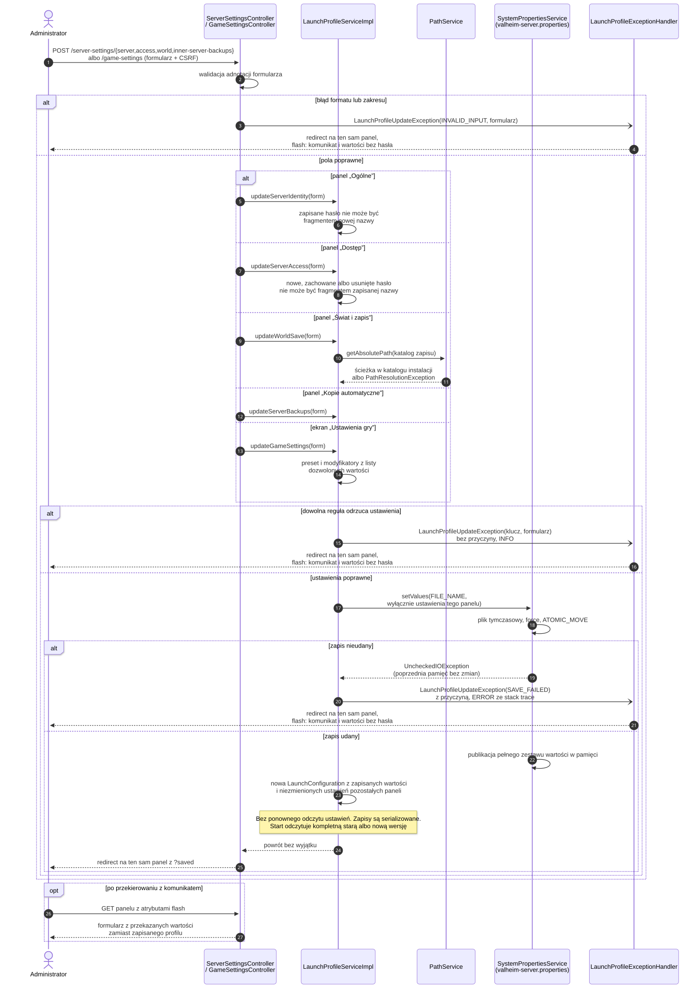

Źródło diagramu: [`diagramy/launch/przeplyw-zapis-profilu.mmd`](diagramy/launch/przeplyw-zapis-profilu.mmd)

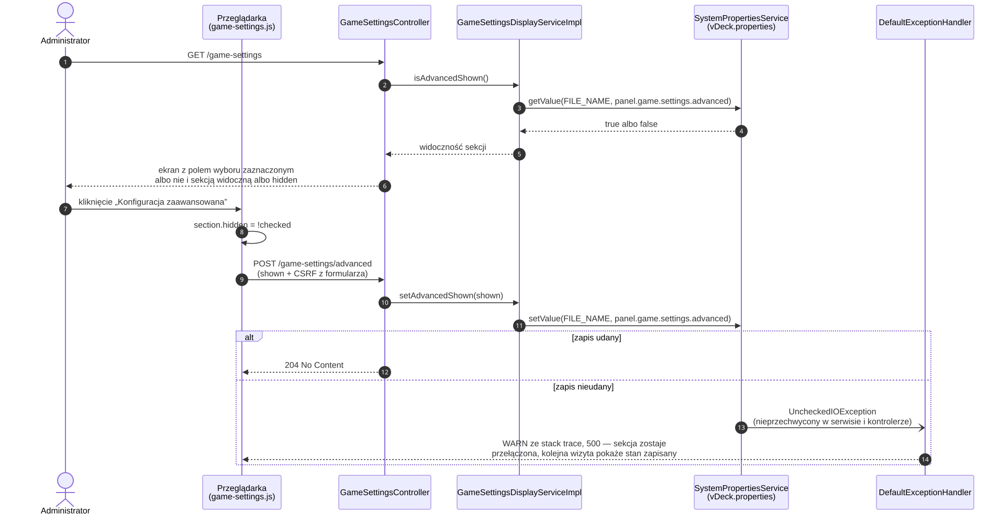

Źródło diagramu: [`diagramy/launch/przeplyw-sekcja-zaawansowana.mmd`](diagramy/launch/przeplyw-sekcja-zaawansowana.mmd)

Komponenty:

| Element | Rola |
|---|---|
| `ServerSettingsController` | `GET` i `POST /server-settings`; publikuje formularz (przekazany po odrzuceniu albo z zapisanego profilu) i informację `passwordSet`, po sukcesie przekierowuje z `?saved` |
| `GameSettingsController` | `GET` i `POST /game-settings`; publikuje formularz (przekazany po odrzuceniu albo z zapisanego profilu), listy opcji i widoczność sekcji `advancedShown`, po sukcesie przekierowuje z `?saved`; `POST /game-settings/advanced` zapamiętuje widoczność i odpowiada `204`, a nieudany zapis obsługuje `DefaultExceptionHandler` odpowiedzią `500` |
| `LaunchProfileExceptionHandler` | `@ControllerAdvice` obu kontrolerów: loguje odrzucenie (`INFO`) albo niepowodzenie (`ERROR` ze stack trace) i przekierowuje na wysłany ekran z komunikatem i formularzem jako atrybutami flash |
| `LaunchProfileMessage` | Zamknięty zbiór kluczy komunikatów: `INVALID_INPUT`, `INVALID_SAVE_DIRECTORY`, `PASSWORD_PART_OF_NAME`, `SAVE_FAILED` |
| `domain.LaunchProperty` | Enum ustawień pliku `valheim-server.properties`: klucz, wartość domyślna i obowiązkowość |
| `domain.LaunchProfile` | Gotowy, bezsekretny widok profilu dla ekranów; hasło reprezentuje wyłącznie `passwordSet` |
| `domain.LaunchConfiguration` | Jedna niemutowalna wersja profilu i hasła dla walidacji oraz budowania komendy; nigdy nie trafia do modelu webowego |
| `domain.WorldPreset`, `WorldModifier`, `WorldKey` | Zamknięte zbiory presetów, modyfikatorów z ich dozwolonymi wartościami i kluczy `-setkey` |
| `exc.LaunchProfileUpdateException` | Wyjątek procesu zapisu: klucz `LaunchProfileMessage`, przesłany formularz (ekranu „Serwer” bez hasła) i — przy nieudanym zapisie — przyczyna |
| `dto.ServerSettingsForm` | Rekord formularza ekranu „Serwer” z walidacją; `toString()` redaguje hasło, `withoutPassword()` usuwa je przed ponownym wyświetleniem |
| `dto.GameSettingsForm` | Rekord formularza ekranu „Ustawienia gry”: preset, modyfikatory i klucze świata |
| `service.LaunchProfileService` / `impl.LaunchProfileServiceImpl` | Mapowanie przez `PropertyReader` przy inicjalizacji, budowa nowej konfiguracji z zapisanych wartości po zapisie, odczyt gotowej konfiguracji oraz osobny zapis ustawień każdego ekranu (`updateServerSettings`, `updateGameSettings`) przez `SystemPropertiesService` z nazwą pliku `LaunchProperty.FILE_NAME` |
| `service.GameSettingsDisplayService` / `impl.GameSettingsDisplayServiceImpl` | Odczyt (`PropertyReader.readBoolean`) i zapis widoczności sekcji „Zaawansowane” przez `SystemPropertiesService` z nazwą pliku `VdeckProperty.FILE_NAME`; wartość inna niż `true`/`false` oznacza sekcję ukrytą |

Konfigurację startową publikuje `LaunchProfileService.reload()` po wczytaniu plików przez
`SystemPropertiesInitializer`. Po każdym udanym zapisie z obu ekranów serwis nie wywołuje
`reload()`: nową konfigurację buduje z właśnie zapisanych wartości ekranu oraz niezmienionych
ustawień drugiego ekranu z bieżącej wersji, bez ponownego odczytu ustawień. `getProfile()` i
`getConfiguration()` zwracają gotowe obiekty, bez ponownego parsowania propertiesów. Zapis i
publikacja są serializowane; równoległy Start zachowuje przechwyconą, kompletną wersję.
Błąd zapisu pozostawia poprzednią konfigurację. `PropertiesFile` również publikuje nowe wartości
dopiero po zapisie i serializuje własnych zapisujących. Ręczna edycja pliku nadal wymaga restartu
panelu; `reload()` odczytuje pamięć, nie dysk. Kontrole gotowości do startu nie blokują otwarcia
panelu w celu poprawienia profilu.

Wartość zapisana w pliku, która nie pasuje do ustawienia — np. po ręcznej edycji — jest przy odczycie
przez `PropertyReader` zastępowana wartością domyślną, a nieznany preset albo wartość modyfikatora są
pomijane; oba przypadki są odnotowywane w logu na poziomie `WARN`. Plik nie jest wtedy przepisywany.

### 5.7 Uruchamianie serwera

Feature `server` uruchamia zapisany profil przez `POST /server/start`, wymagający roli `ADMIN` i CSRF.
`ServerController` deleguje do `service.ServerService`; implementacja `service.impl.ServerServiceImpl`
pobiera gotową `LaunchConfiguration` przez `LaunchProfileService.getConfiguration()`, waliduje ją,
wybiera nową ścieżkę logu i buduje bezpośrednio `LaunchSpec`. Z tej samej specyfikacji renderuje
skrypt lustrzany, zapisuje go i przekazuje specyfikację do `runtime.api.ServerRuntime`.
Walidator i generator komendy nie pobierają ponownie hasła ani pozostałych ustawień profilu.

Po przyjęciu startu następuje przekierowanie na `/` z atrybutem flash `serverStarted`.
Odrzucenie lub błąd kończy się `exc.ServerStartException`; `ServerExceptionHandler` loguje go
i przekierowuje na `/` z `serverErrorKey`. Przeglądarka otrzymuje przetłumaczony komunikat bez
przyczyny technicznej i bez hasła. Przyjęcie startu oznacza utworzenie procesu, a nie gotowość gry.

Walidacja przed utworzeniem procesu:

| Sprawdzenie | Komunikat (`ServerMessage`) | Znaczenie dla administratora |
|---|---|---|
| Stan pozwala na start | `ALREADY_RUNNING` | Serwer już startuje lub działa |
| Zwykły plik `valheim_server.exe` istnieje | `EXECUTABLE_MISSING` | Brak pliku wykonywalnego serwera |
| Nazwa serwera, świata i katalog zapisu są niepuste | `PROFILE_INCOMPLETE` | Uzupełnij profil |
| Niepuste hasło ma co najmniej 5 znaków | `PASSWORD_TOO_SHORT` | Hasło jest za krótkie |
| Hasło nie występuje w nazwie, niezależnie od wielkości liter | `PASSWORD_PART_OF_NAME` | Zmień hasło lub nazwę serwera |
| Publiczny serwer ma hasło | `PUBLIC_REQUIRES_PASSWORD` | Ustaw hasło albo wyłącz publiczność |
| Port UDP i port +1 są wolne | `PORT_IN_USE` | Zwolnij porty albo zmień port profilu |
| Katalog świata jest dozwolony i zapisywalny | `SAVE_DIRECTORY_NOT_WRITABLE` | Popraw ścieżkę lub uprawnienia |
| Można przygotować katalog logu | `LOG_DIRECTORY_NOT_WRITABLE` | Popraw katalog logów lub jego uprawnienia |

Stan jest sprawdzany ponownie w kolejce runtime, więc dwa równoległe żądania nie tworzą dwóch
zarządzanych procesów. Utrata wyścigu daje `ALREADY_RUNNING`; błąd tworzenia procesu daje
`START_FAILED` z zachowaną przyczyną techniczną. Próbne bindowanie portów nie rezerwuje ich aż do startu.

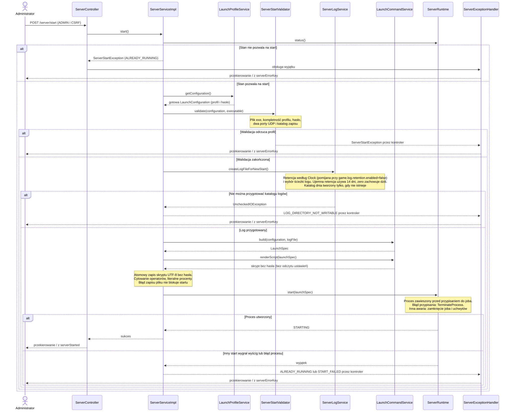

Źródło diagramu: [`diagramy/server/przeplyw-uruchomienie-serwera.mmd`](diagramy/server/przeplyw-uruchomienie-serwera.mmd)

`LaunchCommandServiceImpl` dodaje stałe `-nographics -batchmode`, opcje profilu i absolutne `-logFile`.
Hasło trafia wyłącznie do rzeczywistego argumentu procesu. Środowisko potomka zawiera środowisko
panelu oraz `SteamAppId` odczytany ze skryptu producenta wskazanego przez `server.start.script`.
Brak pliku lub wpisu oraz błąd odczytu dają ostrzeżenie i wartość zastępczą `892970`.
Panel nie uruchamia ani nie zmienia skryptu producenta.

Metoda `LaunchCommandService.renderScript(launchSpec)` nie czyta ustawień ani plików.
Skrypt `.vDeck/vDeck-server-start.bat` jest regenerowanym, atomowo zapisywanym artefaktem
diagnostycznym, bez własnego ekranu. Zamiast hasła zawiera `-password "%VDECK_SERVER_PASSWORD%"`.
Zapis UTF-8 i nagłówek `chcp 65001` zachowują polskie znaki. Operatory powłoki w argumentach
są cytowane, literalne procenty podwajane, a delayed expansion wyłączone. Niesekretne wartości
profilu nie zawierają osadzonych podwójnych cudzysłowów, zgodnie z walidacją formularza.
Błąd zapisu skryptu jest logowany i nie blokuje właściwego startu. Panel uruchamia plik exe
bezpośrednio, przez `WindowsProcessLauncher` i FFM `CreateProcessW`, w katalogu instalacji.

`ServerLogServiceImpl` wybiera `<game.log.directory>/<rrrr-MM-dd>/<rrrr-MM-dd_HH-mm-ss>.log`.
Domyślny katalog to `.vDeck/log`; gdy plik już istnieje, nazwa dostaje przyrostek `-1`, `-2` itd.
Plik tworzy serwer przez `-logFile`; panel nie przekierowuje konsoli. Przed startem, gdy
`game.log.retention.enabled` ma wartość `true` (domyślnie), usuwa katalogi dzienne starsze niż
bieżąca data minus `game.log.retention.days` (domyślnie 14); dzień graniczny i katalogi o nazwach
innych niż daty zostają. Przy `false` wszystkie logi są zachowywane, a liczba dni nie jest czytana.
Błąd retencji jest ostrzeżeniem i nie blokuje startu. Zero zachowuje bieżący dzień; wartość ujemna
lub nienumeryczna daje domyślne 14 dni. Katalog bieżącego dnia jest tworzony tylko wtedy, gdy jeszcze
nie istnieje. Datę wyznacza wstrzykiwany `Clock`, produkcyjnie w lokalnej strefie czasowej.
Usuwanie starych katalogów realizuje pakietowa klasa `ServerLogRetention`, a akcje na katalogach —
nazwę i rozpoznanie katalogu dnia, utworzenie brakującego katalogu i rekurencyjne usunięcie —
`ServerLogDirectories`; obie leżą w `feature.server.service.impl`, a ustawienia czyta serwis.

`ServerStateMachine` jest pojedynczym właścicielem procesu i stanu. Zmiany serializuje jedna kolejka;
odczyt zwraca opublikowany `ServerStatus`. Po 5 sekundach życia proces przechodzi z `STARTING`
do `RUNNING`; nie jest to potwierdzenie gotowości na podstawie logu. Wyjście podczas startu daje
`START_FAILED`, późniejsze — `CRASHED`. Powiadomienia ze starego uruchomienia są odrzucane przez
`operationId`. Błąd samego tworzenia procesu pozostawia poprzedni stan.
Pakietowy konstruktor przyjmuje serializującą kolejkę `ScheduledExecutorService`; runtime
pozostaje jej właścicielem i zamyka ją również po błędzie kończenia procesu. Testy sterują
dostarczeniem zdarzeń oraz potwierdzeń startu bez oczekiwania na upływ czasu.


Źródło diagramu: [`diagramy/server/przeplyw-stany-serwera.mmd`](diagramy/server/przeplyw-stany-serwera.mmd)

Zgodnie z AD-017 `KILL_ON_JOB_CLOSE` chroni tylko nieukończone tworzenie procesu.
Launcher wyłącza flagę przed udanym przekazaniem własności runtime. Nieudany Stop pozostawia
żywy serwer, również po zamknięciu lub awarii panelu. `close()` zamyka zasoby bez kończenia procesu;
asynchroniczny `ServerShutdownLifecycle` wcześniej próbuje wykonać zwykły Stop. Mechanizm
odzyskiwania i token zapobiegają uruchomieniu drugiej instancji; szczegóły w [5.10](#510-zatrzymanie-snapshoty-i-odzyskiwanie).

`WindowsProcessLauncher` otrzymuje granicę wywołań `Win32`, funkcję wyszukiwania `ProcessHandle`
i zegar. Testy zastępują granice systemowe bez uruchamiania procesów. Błąd konfiguracji joba
lub tworzenia procesu zamyka job; po utworzeniu procesu launcher zawsze zwalnia uchwyty procesu
i wątku. Nieudane przypisanie do joba wymaga bezpośredniego `TerminateProcess`, ponieważ job
nie jest jeszcze właścicielem procesu. Po udanym przypisaniu awaria wznowienia lub brak
`ProcessHandle` powodują zamknięcie joba. Błąd awaryjnego zakończenia jest dołączany jako
wyjątek suppressed do pierwotnej awarii przypisania. Zamknięty job nie jest zachowywany do ponownego startu.


Źródło diagramu: [`diagramy/server/klasy-komponenty.mmd`](diagramy/server/klasy-komponenty.mmd)

### 5.8 Przycisk strony głównej

Przycisk strony głównej jest osobnym komponentem wspólnym, niezależnym od menu bocznego — plik
`templates/common/home-button.html` z fragmentem `homeButton`. Osadzają go te same widoki co menu
boczne (strona główna, „Serwer”, „Ustawienia gry” i zmiana hasła na żądanie), każdy osobnym
`th:replace`. To zwykły odnośnik do `/` bez własnego skryptu; jego jedynym działaniem jest przejście na
stronę główną. Nazwę dostępną i podpowiedź daje klucz `homeButton.label` („Strona główna”), a ikonę —
`icon-home`.

- Przycisk jest okrągły, w tym samym stylu co przycisk menu bocznego: oba używają wspólnej klasy
  `.round-button` (obręcz, powierzchnia, cień oraz stany najechania, fokusu i wciśnięcia).
- Ma połowę średnicy przycisku menu i przylega do niego od zewnątrz, z prawej strony: oba koła są
  styczne, a ich dolne krawędzie leżą na jednej linii. Położenie wynika z tokenów
  `--home-button-size` i `--home-button-inset-inline` w `variables.css`.
- Widoczne koło jest mniejsze niż minimalny obszar dotyku, dlatego niewidoczny pseudo-element
  powiększa obszar aktywny do `--control-touch-size`.
- Otwarte menu boczne wysuwa się w miejscu przycisku, więc przycisk leży pod menu i jest ukryty na
  czas jego otwarcia; ukrycie usuwa go też z kolejności tabulacji.

### 5.9 Techniczny helper CTRL+C

Zaimplementowany helper wysyła CTRL+C na żądanie `ServerStateMachine`. Bean `ConsoleControlSender`
jest tworzony przy starcie panelu i pozostaje bezczynny do wywołania przez worker zatrzymania.
Po wymaganym snapshotcie implementacja `JvmConsoleControlSender` uruchamia osobną JVM
z pliku `<instalacja>/lib/vdeck-runner.jar` z argumentami:
`--ctrl-sender <pid> <creation-instant> <absolute-executable>` i włączonym dostępem natywnym.
Argumenty nie zawierają hasła ani opcji profilu serwera. `JvmConsoleControlSender` uruchamia `javaw.exe` przez ProcessBuilder, bez powłoki,
z zamkniętym stdin i odrzuconym wyjściem. Timeout helpera wynosi najwyżej 10 s;
sprzątanie po timeout dotyczy tylko helpera.

Polecenie przekazuje konfiguracja Springa po rozwiązaniu ścieżki przez `PathService`.
Każde wywołanie uruchamia nowy proces; bean nie utrzymuje stale działającego helpera.
Brak lub uszkodzenie JAR-a powoduje błąd helpera przy żądaniu sygnału; Stop pozostawia serwer uruchomiony.
Artefakt jest wymagany także dla IDE i `spring-boot:run` — brak fallbacku do punktu wejścia panelu.

`runner.VdeckRunner` obsługuje wyłącznie tryb techniczny, bez Springa, bazy i ustawień panelu.
`runtime.api.ControlSenderCommand` wymaga dokładnie czterech argumentów i waliduje PID,
czas oraz absolutną, znormalizowaną ścieżkę. `runtime.api.ProcessIdentity` potwierdza PID,
rzeczywisty czas utworzenia z `ProcessHandle.Info.startInstant()`, plik wykonywalny rozwiązany
przez `toRealPath()` i żywotność procesu. Czas pobrany z zegara panelu nie wystarcza jako token.

`runtime.windows.WindowsConsoleControlSender` sprawdza tożsamość przed zmianą konsoli, wykonuje
`FreeConsole`, `AttachConsole`, ustawia ignorowanie CTRL+C przez helper, ponownie weryfikuje proces
i wysyła `GenerateConsoleCtrlEvent( 0, 0 )`. Po przyłączeniu zawsze próbuje odłączyć konsolę,
także przy błędzie. Błąd sprzątania jest dołączany do pierwotnego jako wyjątek suppressed.
Wywołań tych nie wolno wykonywać w głównej JVM panelu, ponieważ zmieniają jej ustawienia konsoli.

| Kod wyjścia helpera | Znaczenie |
|---|---|
| `0` | Wysłano CTRL+C; nie potwierdza to zapisu świata ani wyjścia serwera |
| `1` | Błąd sygnału, sprzątania lub weryfikacji tożsamości |
| `2` | Błędne argumenty; nie tworzono granicy natywnej ani kontekstu Springa |

Testy jednostkowe zastępują procesy i Win32, a pliki exe są pustymi plikami w `@TempDir`.
Nie wysyłają sygnału do rzeczywistego serwera. Potwierdzenie zachowania CTRL+C i spójności zapisu
na rzeczywistym Valheim pozostaje testem wdrożeniowym Windows.


Źródło diagramu: [`diagramy/server/przeplyw-helper-ctrl-c.mmd`](diagramy/server/przeplyw-helper-ctrl-c.mmd)

### 5.10 Zatrzymanie, snapshoty i odzyskiwanie

Wyspa wysyła Stop z ukrytym launchId. Kill otwiera `GET /server/kill-confirmation`, który
wyłącznie pokazuje ryzyko; formularz POST wymaga zaznaczenia potwierdzenia i ponownie weryfikuje
identyfikator uruchomienia. ADMIN, CSRF i wymuszona zmiana hasła obowiązują jak dla Start.
Błędy synchroniczne kończą się wyjątkiem procesu i komunikatem flash, a wynik operacji
asynchronicznej jest widoczny w statusie. Nieaktualne formularze i sprzeczne operacje są odrzucane.

Runtime przed opublikowaniem STARTING weryfikuje `ProcessIdentity`. Nieudana weryfikacja sprząta
nieprzekazany proces. Po przejęciu błąd zapisu tokenu nie odbiera własności ani możliwości Stop i Kill.

Stop: pełny snapshot PRE_STOP, CTRL+C, 120 s oczekiwania, jedno powtórzenie CTRL+C i 30 s.
Każdy helper ma najwyżej 10 s. Niepowodzenie daje STOP_FAILED z zachowaniem procesu, bez wymuszenia.
Kill: po jednym potwierdzeniu użytkownika panel próbuje wykonać backup, a potem od razu
wywołuje destroyForcibly, także gdy kopia nie powstanie. Kill nie wysyła CTRL+C ani nie czeka
na próby łagodne. Ekran potwierdzenia ostrzega o utracie danych również bez backupu. Nie ma
dodatkowego checkboxa ani wymogu wcześniejszego błędu kopii. Po wymuszeniu panel czeka do 10 s
na wyjście. Każda operacja ma deadline 5 min, obejmujący kopię. Anulowanie, przerwanie workera,
brak pewnej tożsamości lub czasu nadal zabrania wymuszenia; zgoda nie przechodzi na kolejne żądania.
Sukces API sygnału nie potwierdza wyjścia ani zapisu; STOPPED wymaga obserwacji wyjścia.
Shutdown dołącza do aktywnej operacji albo zleca Stop bez zgody na wymuszenie. Faza Springa ma 6 min.
RCON nie jest brany pod uwagę.


Źródło: [przeplyw-zatrzymanie-serwera.mmd](diagramy/server/przeplyw-zatrzymanie-serwera.mmd).

Snapshot używa świata i saveDirectory przechwyconych przy starcie, niezależnie od późniejszej
edycji profilu. AD-018 wyznacza `<instalacja>/.vDeck/<snapshot.directory>` przez osobny
`BackupPathService`; katalog jest zapisywany w tokenie `server.pid`, więc adopcja używa tego
samego katalogu co start, a runtime odmawia snapshotu poza `.vDeck`. Instalacja jest kanonizowana na wejściu, więc spacje, polskie znaki i junction
powyżej niej są obsługiwane. Writer sprawdza ścieżki od zaufanej instalacji lub katalogu backupów
w dół, odrzucając dowiązania i junctions poniżej granicy. Kopiuje parę
`.db`/`.fwl` z obecnymi `.old` lub pełny katalog `worlds_local/<świat>`, sprawdzając zestaw plików,
mtime, rozmiary oraz tożsamość plików przed i po kopii. `FileIdentityReader` otrzymuje na Windows
numer woluminu i 128-bitowy FileId przez `GetFileInformationByHandleEx(FileIdInfo)`, bez blokowania
zapisów i rename. Brak identyfikatora odrzuca próbę; writer wykonuje do trzech prób całości.
Manifest zawiera PRE_STOP, BEST_EFFORT, operację,
świat, czas, rozmiary i SHA-256. Pliki są utrwalane i publikowane przez ATOMIC_MOVE.
Brak wymaganego `.db`/`.fwl` lub katalogu `worlds_local` daje WORLD_SAVE_MISSING:
komunikat wyjaśnia brak źródłowego zapisu, w tym świata mającego tylko `.fwl`. Nie tworzy się
pozornej kompletnej kopii. Stop pozostawia proces uruchomiony; potwierdzony Kill loguje błąd
kopii i kontynuuje wymuszenie. Pozostałe błędy kopii zatrzymują Stop z SNAPSHOT.
BEST_EFFORT nie gwarantuje semantycznej spójności świata ani trwałości rename po utracie zasilania.

Limit pojedynczego zestawu: 8 GiB, 8192 wpisy, głębokość poniżej 16 i bufor kopiowania 64 KiB.
Zgodnie z AD-019 writer utrzymuje `snapshot-latest`. Nowa kopia powstaje w `.tmp-<uuid>`;
dopiero po jej ukończeniu poprzednia trafia przez ATOMIC_MOVE do `.old-<uuid>`, a nowa na jej miejsce.
Błąd publikacji przywraca poprzednią kopię. Po sukcesie stara jest usuwana; błąd sprzątania daje WARN.
Następna operacja najpierw odzyskuje `.old-*`, gdy nie ma `snapshot-latest`, potem sprząta pozostałości
`.tmp-*` i `.old-*`. Nie ma limitu 32 wpisów; potrzebne jest wolne miejsce na nowy zestaw obok starego.
Starsze katalogi `snapshot-<operationId>` nie są kasowane automatycznie. Ekran backupów pozostaje
osobną funkcją.


Źródło: [przeplyw-snapshot.mmd](diagramy/backup/przeplyw-snapshot.mmd).

`.vDeck/vdeck.lock` blokuje drugi panel dla tej instalacji. `.vDeck/server.pid` przechowuje bez
sekretów launchId, PID, rzeczywisty czas utworzenia, exe, świat, saveDirectory i log. Po restarcie
panel skanuje procesy także po błędzie odczytu tokenu. Kandydaci z tej instalacji lub żywy zapisany
PID blokują Start w RECOVERY_REQUIRED. Jeśli token jest uszkodzony, a skan nie znajduje serwera,
plik trafia do kwarantanny `server.pid.invalid-<czas>-<uuid>` z WARN i Start zostaje odblokowany.
Odczyt poprawnego tokenu nie wymaga istnienia saveDirectory; jego kontrola następuje przy snapshotcie.
Pojedynczy proces ze zgodnym tokenem może zostać jawnie adoptowany
przez POST /server/adopt po ponownej weryfikacji tożsamości. Zniknięcie procesu lub nieaktualny wybór
kończy `ServerAdoptException(ADOPT_REJECTED)` bez przyczyny, logowany na INFO; awaria infrastruktury
używa ADOPT_FAILED z przyczyną i ERROR. Pozostałe przypadki wymagają
interwencji poza panelem; nie ma automatycznej adopcji lub zabijania. Po zniknięciu kandydatów
odczyty statusu zlecają ponowne sprawdzenie, które może odblokować Start.


Źródło: [przeplyw-odzyskiwanie.mmd](diagramy/server/przeplyw-odzyskiwanie.mmd).

### 5.11 Konsola

Feature `logs` pokazuje w panelu log bieżącego uruchomienia serwera Valheim. Konsola jest na razie
tylko podglądem: nie przyjmuje poleceń i nie przechwytuje konsoli procesu. Czyta plik, który serwer
sam zapisuje przez `-logFile` (patrz [5.7](#57-uruchamianie-serwera)).

Widoczne zachowanie:

- Ekran `/console` otwiera pozycja „Konsola” z sekcji „Procesy” menu bocznego. Karta zawiera
  przewijane okno logu (`pre[role=log]`). Strona się nie przewija, a długie linie zawijają się zamiast
  poszerzać kartę.
- Okno jest puste, gdy panel nie zna logu uruchomienia — przed pierwszym startem i po zatrzymaniu
  serwera (`ServerStatus.stopped()` nie ma ścieżki logu). Po nieudanym starcie albo awarii
  (`START_FAILED`, `CRASHED`) pokazuje log tego uruchomienia. Po adopcji ścieżka pochodzi z tokenu
  `server.pid`.
- `console.js` pyta co sekundę o nowe linie i dopisuje je na końcu. Okno przewija się w dół tylko
  wtedy, gdy administrator był przy jego końcu, więc czytanie starszych linii nie jest przerywane.
  Okno trzyma najwyżej 5000 linii; starsze są usuwane.
- Nowe uruchomienie zmienia nazwę pliku (`source`), więc okno zaczyna od nowa bez przeładowania strony.

Przebieg odpytywania:

- `GET /console/log?offset=N` (`ConsoleController.readLog`) zwraca JSON `LogChunk` z polami `source`
  (sama nazwa pliku, bez ścieżki instalacji), `offset`, `text` i `reset`. Pierwsze żądanie nie ma
  `offset`.
- `LogServiceImpl.readCurrent` bierze plik wyłącznie z `ServerService.getStatus().getLogFile()` —
  klient wybiera tylko miejsce kontynuacji, nigdy plik. Plik jest otwierany przez `FileChannel` z
  `NOFOLLOW_LINKS`. Java na Windows otwiera go ze współdzieleniem odczytu i zapisu, więc nie blokuje
  serwera. Między żądaniami nic nie jest trzymane w pamięci.
- Brak `offset`, wartość ujemna albo większa niż rozmiar pliku zwraca ostatnie 256 KiB (`TAIL_BYTES`)
  z `reset = true`. Pierwsza, prawdopodobnie ucięta linia takiej końcówki jest pomijana.
- Kontynuacja zwraca najwyżej 256 KiB (`MAX_CHUNK_BYTES`), uciętych do ostatniego znaku nowej linii.
  Niedokończona linia przychodzi więc w całości w kolejnym żądaniu, a znak UTF-8 nie jest dzielony.
  Tylko pełny blok bez żadnego znaku nowej linii jest zwracany w całości, aby jedna ogromna linia
  nie zatrzymała odczytu.
- Tekst jest dekodowany jako UTF-8 z zastępowaniem błędnych bajtów, a znaki `\r` są usuwane.
- Gdy serwer jeszcze nie utworzył pliku, odpowiedź jest pusta (`NoSuchFileException` jest
  udokumentowaną wartością zastępczą). Inny błąd odczytu staje się `UncheckedIOException`.
  `DefaultExceptionHandler` loguje go na `WARN` i zwraca `500`, a okno zachowuje ostatni stan.
- Przeglądarka nie wysyła żądania, gdy strona jest ukryta albo poprzednie żądanie jeszcze trwa. Tekst
  trafia do okna wyłącznie jako węzeł tekstowy, nigdy jako HTML.

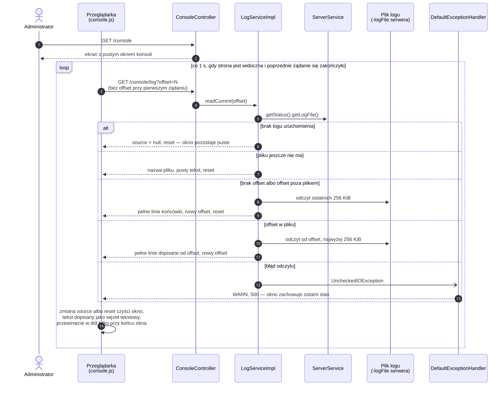

Źródło diagramu: [`diagramy/logs/przeplyw-konsola.mmd`](diagramy/logs/przeplyw-konsola.mmd)

| Komponent | Pakiet | Rola |
|---|---|---|
| `ConsoleController` | `feature.logs` | `GET /console` (widok `logs/console`) i `GET /console/log` (JSON) |
| `LogChunk` | `feature.logs.dto` | Odpowiedź jednego odpytania; `LogChunk.none()` dla panelu bez logu |
| `LogService` / `LogServiceImpl` | `feature.logs.service` / `.impl` | Przyrostowy odczyt pliku bieżącego uruchomienia |
| `console.js`, `console.css` | `static/js`, `static/css` | Odpytywanie co 1 s, dopisywanie tekstu, przewijane okno |

Oba adresy wymagają roli `ADMIN` jak każdy inny. Są to żądania `GET` bez skutków ubocznych, więc nie
potrzebują CSRF. Konsola nie ma własnych ustawień.

## 6. Bezpieczeństwo

Zaimplementowane mechanizmy przekrojowe:

- **Hasła.** Wyłącznie hashe adaptacyjne z `PasswordEncoderFactories.createDelegatingPasswordEncoder()`,
  czyli aktualna rekomendacja Spring Security wraz z identyfikatorem enkodera w zapisanej wartości.
  Ten sam enkoder obsługuje hasło początkowe i zmienione, więc zmiana rekomendacji nie wymaga migracji.
- **Brak wycieku sekretów.** Hasła jawne nie są logowane ani zwracane w `toString()`. Serwis ustawień
  loguje tylko nazwy kluczy. Logi zmiany hasła nie zawierają nazwy konta ani wartości.
- **Domyślne poświadczenia.** Konto `admin`/`admin` jest bezużyteczne poza formularzem wymuszonej
  zmiany hasła — ograniczenie jest egzekwowane po stronie serwera przy każdym żądaniu, a nie tylko
  po zalogowaniu.
- **Dostęp.** Wszystkie żądania poza `/initial-password-change` wymagają roli `ADMIN`. Adres
  `/initial-password-change` wymaga uprawnienia `PASSWORD_CHANGE_REQUIRED`, ponieważ zmienia hasło
  bez weryfikacji aktualnego; konto, które wybrało już własne hasło, dostaje na nim `403`, a serwis
  odrzuca takie żądanie również wtedy, gdy trafi do niego z pominięciem łańcucha. Konto z hasłem
  początkowym poza tym adresem osiąga tylko katalogi zasobów statycznych `/css/`, `/icons/`
  i `/img/`; wyjątek jest dopasowywany po początku ścieżki i nie zdejmuje wymagania roli.
- **Ekspozycja sieciowa.** Adres nasłuchu nie jest ograniczony w pliku aplikacji; lokalne uruchomienie
  wymaga jawnego `--server.address=127.0.0.1`, które launcher przekazuje z `panel.address`.
- **Aktualizacje.** Kod z paczki uruchamia się dopiero po HTTPS, zgodności rozmiaru i SHA-256 z API
  GitHuba oraz walidacji rozpakowania; adres repozytorium jest zapisany w kodzie, a wydania są
  niezmienne. Bez podwyższania uprawnień. Ścieżki podmiany pochodzą z zamkniętej listy, dziennik
  jest traktowany jako niezaufane wejście, a katalogi są sprawdzane pod kątem przekierowań.
- **Granice systemu plików.** Każda skonfigurowana ścieżka przechodzi przez `PathService` i nie może
  opuścić katalogu instalacyjnego — także przez dowiązania i junction (patrz [3.3](#33-rozwiązywanie-ścieżek)).
- **Trwałość ustawień.** Zapis pliku ustawień jest atomowy i wymuszony na urządzenie, więc utrata
  zasilania nie zostawia pustego pliku konfiguracji.
- **Hasło serwera Valheim.** Serwer wymaga hasła w wierszu poleceń, więc jest ono przechowywane
  jawnym tekstem w `.vDeck/config/valheim-server.properties` (`AD-013`). Chronią je wyłącznie
  uprawnienia konta systemowego do katalogu instalacyjnego. Plik trafia do każdej kopii katalogu
  instalacyjnego i jest usuwany razem z nim. Hasło nigdy nie jest odsyłane do przeglądarki — ani po
  zapisie, ani po odrzuceniu formularza. Nie trafia do logu, a `ServerSettingsForm.toString()` je
  redaguje. Odpowiedzi panelu dostają nagłówki Spring Security zakazujące cache'owania.

## 7. Persystencja

Bazą jest jednoplikowy SQLite (`vdeck.db`) obsługiwany przez Spring Data JPA z dialektem
`org.hibernate.community.dialect.SQLiteDialect`. Schemat jest utrzymywany przez `ddl-auto: update`.

Obecnie utrwalana jest jedna encja — `PanelUser` w tabeli `panel_users`. Repozytorium `UserRepository`
rozszerza `JpaRepository< PanelUser, String >` i nie deklaruje własnych metod. Operacje zmieniające
stan (`DataInitializer.run`, `PanelUserServiceImpl.changePassword` oraz
`PanelUserServiceImpl.changeInitialPassword`) są `@Transactional`; zmiana hasła zapisuje się przez
dirty checking zarządzanej encji, bez jawnego `save`.

## 8. Logowanie zdarzeń

Log4j2 jest jedynym API i backendem logowania; `spring-boot-starter-logging` jest wykluczony ze
wszystkich starterów, które go wciągają. Klasy produkcyjne używają Lombokowego `@Log4j2`.

Zdarzenia rejestrowane obecnie:

| Poziom | Zdarzenie |
|---|---|
| `INFO` | Rozwiązanie katalogu bazowego; utworzenie pliku ustawień z domyślnymi wartościami; wczytanie ustawień; zmiana ustawienia albo liczba ustawień zmienionych naraz; utworzenie domyślnego administratora; zmiana hasła na życzenie użytkownika; zmiana hasła początkowego wraz ze zdjęciem ograniczenia pierwszego logowania; żądanie zapisu ustawień ekranu „Serwer” albo „Ustawienia gry”, ich zapis albo — w `LaunchProfileExceptionHandler` — odrzucenie z nazwą `LaunchProfileMessage`; pokazanie albo ukrycie sekcji „Zaawansowane” |
| `WARN` | Przywrócenie domyślnej wartości brakującego ustawienia; nieudane usunięcie pliku tymczasowego; wartość ustawienia niepasująca do niego, zastąpiona wartością zastępczą albo pominięta (`PropertyReader`, z nazwą ustawienia i pliku) — w tym w profilu uruchomieniowym i w `panel.game.settings.advanced`, traktowanej wtedy jako sekcja ukryta; wyjątek nieobsłużony przez feature (`DefaultExceptionHandler`, z metodą i ścieżką żądania oraz stack trace), w tym nieudany zapis widoczności sekcji „Zaawansowane” |
| `ERROR` | Nieudany zapis pliku profilu uruchomieniowego (`LaunchProfileExceptionHandler`), ze stack trace |
| `DEBUG` | Źródło katalogu bazowego (override albo `ApplicationHome`); pominięcie inicjalizacji istniejącego administratora; odrzucenie zmiany hasła wraz z nazwą `PasswordChangeMessage` (`PasswordChangeExceptionHandler`); powód odrzucenia katalogu zapisu |

Żaden komunikat nie zawiera hasła, hasha ani wartości ustawień. Wpis o odrzuconej zmianie hasła
zawiera wyłącznie nazwę komunikatu, a nie wprowadzone wartości ani nazwę konta.

Launcher i updater zapisują osobny plik logu każdego uruchomienia (sekcja
[1.7](#17-launcher-i-automatyczna-aktualizacja)): wersje, zasób, rozmiar, wynik weryfikacji,
identyfikator transakcji i każdy krok podmiany, bez treści odpowiedzi API i wartości ustawień.

Feature `server` loguje żądanie i przyjęcie startu, ścieżkę logu, retencję oraz zmiany stanu na `INFO`.
Przyczyny walidacji trafiają na `DEBUG`, a odrzucenie obsługiwane przez `ServerExceptionHandler`
na `INFO`. Błąd tworzenia procesu zachowuje stack trace na `ERROR`; błąd zapisu skryptu lustrzanego
lub retencji jest ostrzeżeniem `WARN`. `LaunchSpec.toString()` redaguje argumenty i środowisko.

Feature `logs` nie kopiuje logu serwera do logu aplikacji. Na `DEBUG` zapisuje rozpoczęcie odczytu od
końca pliku, a na `TRACE` — brak pliku przed jego utworzeniem przez serwer. Błąd odczytu loguje
`DefaultExceptionHandler` na `WARN`.

## 9. Stan implementacji i znane ograniczenia

Zaimplementowane: infrastruktura konfiguracji (`shared`), rozwiązywanie ścieżek, uwierzytelnianie
panelu wraz z oboma wariantami zmiany hasła, teksty interfejsu w resource bundle oraz warstwa
interfejsu — arkusze stylów, sprite ikon, komponenty wspólne wyspy akcji, wymagań dla hasła i menu
bocznego, strona główna panelu, oba ostylowane ekrany hasła oraz ekrany „Serwer” i „Ustawienia gry”
zapisujące profil uruchomieniowy. Działa również Start, przygotowanie polecenia i logów oraz runtime
Windows ze stanem procesu opisanym w [5.7](#57-uruchamianie-serwera).

Zaimplementowano również izolowany helper CTRL+C i sprawdzanie tożsamości procesu, opisane
w [5.9](#59-techniczny-helper-ctrlc); Stop, Kill, snapshoty i minimalne recovery opisuje [5.10](#510-zatrzymanie-snapshoty-i-odzyskiwanie).
Launcher, automatyczna aktualizacja vDecka i recovery przerwanej aktualizacji opisuje
[1.7](#17-launcher-i-automatyczna-aktualizacja); podmianę i recovery potwierdziła próba na paczkach
testowych, a pierwszej aktualizacji z prawdziwego wydania GitHuba nie można sprawdzić przed publikacją
dwóch wydań.

**Niezaimplementowane** — wymienione wyłącznie jako kontekst, żaden z tych obszarów nie działa:
Restart z GUI, ekran zarządzania światami i kopiami, restore, wysyłanie poleceń z konsoli,
przeglądanie logów wcześniejszych uruchomień, listy graczy, RCON, mody, harmonogramy i aktualizacje
serwera. Podgląd logu bieżącego uruchomienia opisuje [5.11](#511-konsola).

Plan realizacji Stop i Kill oraz kontrolowanego zamknięcia panelu znajduje się w
[planie implementacji zatrzymania serwera](../.docs/plans/server-stop.md).
Opisuje zaakceptowane AD-017/AD-018 i zrealizowane akcje. Testy automatyczne używają kontrolowanych
procesów i danych; próba CTRL+C, zapisu i recovery na rzeczywistym Valheim Windows pozostaje wymagana.

Znane ograniczenia stanu bieżącego:

- panel nie ma własnej strony logowania — używana jest strona generowana przez Spring Security;
- panel nie ma własnej strony błędu — odpowiedź `500` z `DefaultExceptionHandler` renderuje domyślna
  strona błędu Spring Boota, bez treści wyjątku;
- strona główna pokazuje wyspę, komunikaty operacji i ewentualną adopcję; status wyspy odświeża polling;
- Restart i przyciski kopii bezpieczeństwa nie wykonują jeszcze akcji;
- serwer może przeżyć zamknięcie panelu; nieudany Stop nigdy nie przechodzi automatycznie do Kill;
- menu boczne ma trzy działające pozycje — „Serwer”, „Ustawienia gry” i „Konsola”; pozycja
  w sekcji „Kopie bezpieczeństwa” jest przykładowa (etykieta „Test”) i nie otwiera żadnego panelu;
- konsola odświeża się przez odpytywanie co sekundę, więc nowe linie pojawiają się z opóźnieniem do
  około sekundy, a każda otwarta karta konsoli wysyła jedno żądanie na sekundę;
- hasło serwera Valheim leży w pliku ustawień jawnym tekstem, chronione wyłącznie uprawnieniami
  systemu plików;
- panel jest jednojęzyczny i nie ma mechanizmu zmiany języka; zmiana brzmienia tekstu wymaga nowego
  wydania, a strona logowania generowana przez Spring Security pozostaje angielska niezależnie od
  tekstów panelu;
- rejestracja i zarządzanie kontami nie istnieją: jedynym kontem jest `admin` tworzony przy starcie,
  a `PanelRole` ma jedną wartość;
- brak mechanizmu odzyskiwania dostępu po utracie hasła — odzyskanie wymaga ingerencji w plik bazy;
- ścieżka bazy `jdbc:sqlite:vdeck.db` z `application.yaml` jest względna wobec katalogu roboczego
  procesu i **nie** przechodzi przez `PathService`;
- pliki ustawień są czytane wyłącznie przy starcie, więc ręczna edycja wymaga restartu panelu;
- zapis pliku ustawień gubi komentarze i kolejność kluczy;
- brak testów ArchUnit egzekwujących opisane granice pakietów;
- automatyczna aktualizacja jest pomijana, gdy działa panel albo serwer; przerwana aktualizacja bez
  kompletnego executora wymaga ręcznej naprawy z kopii `.vDeck/update/backup`.

## 10. Indeks diagramów

W treści dokumentu osadzone są wygenerowane obrazki `.svg`, dzięki czemu diagramy są widoczne w każdym
podglądzie Markdown. Źródłem prawdy pozostaje plik `.mmd`; obrazek leży w podkatalogu `img/` obok
źródła i **po każdej zmianie źródła musi zostać wygenerowany ponownie**:

```powershell
npx -y @mermaid-js/mermaid-cli `
  -i dokumentacja\diagramy\<feature>\<nazwa>.mmd `
  -o dokumentacja\diagramy\<feature>\img\<nazwa>.svg `
  -b white -c dokumentacja\diagramy\mermaid-config.json
```

Konfiguracja `mermaid-config.json` wyłącza etykiety HTML — bez tego napisy trafiają do
`foreignObject` i nie wyświetlają się, gdy SVG jest osadzone jako obrazek.

| Diagram | Rodzaj | Obrazek | Źródło | Opisany w |
|---|---|---|---|---|
| Ciągła integracja i wydania | przepływ | [`img/przeplyw-ci-wydanie.svg`](diagramy/wspolne/img/przeplyw-ci-wydanie.svg) | [`diagramy/wspolne/przeplyw-ci-wydanie.mmd`](diagramy/wspolne/przeplyw-ci-wydanie.mmd) | [1.6](#16-ciągła-integracja-i-wydania) |
| Start przez launcher i aktualizacja | przepływ | [`img/przeplyw-start-i-aktualizacja.svg`](diagramy/wspolne/img/przeplyw-start-i-aktualizacja.svg) | [`diagramy/wspolne/przeplyw-start-i-aktualizacja.mmd`](diagramy/wspolne/przeplyw-start-i-aktualizacja.mmd) | [1.7](#17-launcher-i-automatyczna-aktualizacja) |
| Przekazanie blokady instalacji | sekwencja | [`img/przeplyw-przekazanie-blokady.svg`](diagramy/wspolne/img/przeplyw-przekazanie-blokady.svg) | [`diagramy/wspolne/przeplyw-przekazanie-blokady.mmd`](diagramy/wspolne/przeplyw-przekazanie-blokady.mmd) | [1.7](#17-launcher-i-automatyczna-aktualizacja) |
| Transakcja aktualizacji | stany | [`img/przeplyw-transakcja-aktualizacji.svg`](diagramy/wspolne/img/przeplyw-transakcja-aktualizacji.svg) | [`diagramy/wspolne/przeplyw-transakcja-aktualizacji.mmd`](diagramy/wspolne/przeplyw-transakcja-aktualizacji.mmd) | [1.7](#17-launcher-i-automatyczna-aktualizacja) |
| Launcher, updater i kontrakt instalacji | klasy | [`img/klasy-aktualizacja.svg`](diagramy/wspolne/img/klasy-aktualizacja.svg) | [`diagramy/wspolne/klasy-aktualizacja.mmd`](diagramy/wspolne/klasy-aktualizacja.mmd) | [1.7](#17-launcher-i-automatyczna-aktualizacja) |
| Start aplikacji vDeck | przepływ | [`img/przeplyw-start-aplikacji.svg`](diagramy/wspolne/img/przeplyw-start-aplikacji.svg) | [`diagramy/wspolne/przeplyw-start-aplikacji.mmd`](diagramy/wspolne/przeplyw-start-aplikacji.mmd) | [2.2](#22-start-aplikacji) |
| Obsługa wyjątków | przepływ | [`img/przeplyw-obsluga-wyjatkow.svg`](diagramy/wspolne/img/przeplyw-obsluga-wyjatkow.svg) | [`diagramy/wspolne/przeplyw-obsluga-wyjatkow.mmd`](diagramy/wspolne/przeplyw-obsluga-wyjatkow.mmd) | [2.3](#23-obsługa-wyjątków) |
| Infrastruktura konfiguracji | klasy | [`img/klasy-konfiguracja.svg`](diagramy/wspolne/img/klasy-konfiguracja.svg) | [`diagramy/wspolne/klasy-konfiguracja.mmd`](diagramy/wspolne/klasy-konfiguracja.mmd) | [3.4](#34-komponenty-konfiguracji) |
| Logowanie do panelu | przepływ | [`img/przeplyw-logowanie.svg`](diagramy/authentication/img/przeplyw-logowanie.svg) | [`diagramy/authentication/przeplyw-logowanie.mmd`](diagramy/authentication/przeplyw-logowanie.mmd) | [4.4](#44-logowanie) |
| Zmiana hasła w obu wariantach | przepływ | [`img/przeplyw-zmiana-hasla.svg`](diagramy/authentication/img/przeplyw-zmiana-hasla.svg) | [`diagramy/authentication/przeplyw-zmiana-hasla.mmd`](diagramy/authentication/przeplyw-zmiana-hasla.mmd) | [4.5](#45-zmiana-hasła) |
| Feature authentication | klasy | [`img/klasy-komponenty.svg`](diagramy/authentication/img/klasy-komponenty.svg) | [`diagramy/authentication/klasy-komponenty.mmd`](diagramy/authentication/klasy-komponenty.mmd) | [4.7](#47-komponenty-featurea) |
| Menu boczne | przepływ | [`img/przeplyw-menu-boczne.svg`](diagramy/wspolne/img/przeplyw-menu-boczne.svg) | [`diagramy/wspolne/przeplyw-menu-boczne.mmd`](diagramy/wspolne/przeplyw-menu-boczne.mmd) | [5.5](#55-menu-boczne) |
| Zapis profilu uruchomieniowego | sekwencja | [`img/przeplyw-zapis-profilu.svg`](diagramy/launch/img/przeplyw-zapis-profilu.svg) | [`diagramy/launch/przeplyw-zapis-profilu.mmd`](diagramy/launch/przeplyw-zapis-profilu.mmd) | [5.6](#56-serwer-i-ustawienia-gry) |
| Sekcja „Zaawansowane” | sekwencja | [`img/przeplyw-sekcja-zaawansowana.svg`](diagramy/launch/img/przeplyw-sekcja-zaawansowana.svg) | [`diagramy/launch/przeplyw-sekcja-zaawansowana.mmd`](diagramy/launch/przeplyw-sekcja-zaawansowana.mmd) | [5.6](#56-serwer-i-ustawienia-gry) |
| Uruchomienie serwera | sekwencja | [`img/przeplyw-uruchomienie-serwera.svg`](diagramy/server/img/przeplyw-uruchomienie-serwera.svg) | [`diagramy/server/przeplyw-uruchomienie-serwera.mmd`](diagramy/server/przeplyw-uruchomienie-serwera.mmd) | [5.7](#57-uruchamianie-serwera) |
| Stany serwera | stany | [`img/przeplyw-stany-serwera.svg`](diagramy/server/img/przeplyw-stany-serwera.svg) | [`diagramy/server/przeplyw-stany-serwera.mmd`](diagramy/server/przeplyw-stany-serwera.mmd) | [5.7](#57-uruchamianie-serwera) |
| Feature server i runtime | klasy | [`img/klasy-komponenty.svg`](diagramy/server/img/klasy-komponenty.svg) | [`diagramy/server/klasy-komponenty.mmd`](diagramy/server/klasy-komponenty.mmd) | [5.7](#57-uruchamianie-serwera) |
| Techniczny helper CTRL+C | przepływ | [`img/przeplyw-helper-ctrl-c.svg`](diagramy/server/img/przeplyw-helper-ctrl-c.svg) | [`diagramy/server/przeplyw-helper-ctrl-c.mmd`](diagramy/server/przeplyw-helper-ctrl-c.mmd) | [5.9](#59-techniczny-helper-ctrlc) |
| Zatrzymanie serwera | przepływ | [SVG](diagramy/server/img/przeplyw-zatrzymanie-serwera.svg) | [MMD](diagramy/server/przeplyw-zatrzymanie-serwera.mmd) | [5.10](#510-zatrzymanie-snapshoty-i-odzyskiwanie) |
| Snapshot świata | przepływ | [SVG](diagramy/backup/img/przeplyw-snapshot.svg) | [MMD](diagramy/backup/przeplyw-snapshot.mmd) | [5.10](#510-zatrzymanie-snapshoty-i-odzyskiwanie) |
| Odzyskiwanie procesu | przepływ | [SVG](diagramy/server/img/przeplyw-odzyskiwanie.svg) | [MMD](diagramy/server/przeplyw-odzyskiwanie.mmd) | [5.10](#510-zatrzymanie-snapshoty-i-odzyskiwanie) |
| Odpytywanie logu w konsoli | sekwencja | [`img/przeplyw-konsola.svg`](diagramy/logs/img/przeplyw-konsola.svg) | [`diagramy/logs/przeplyw-konsola.mmd`](diagramy/logs/przeplyw-konsola.mmd) | [5.11](#511-konsola) |
